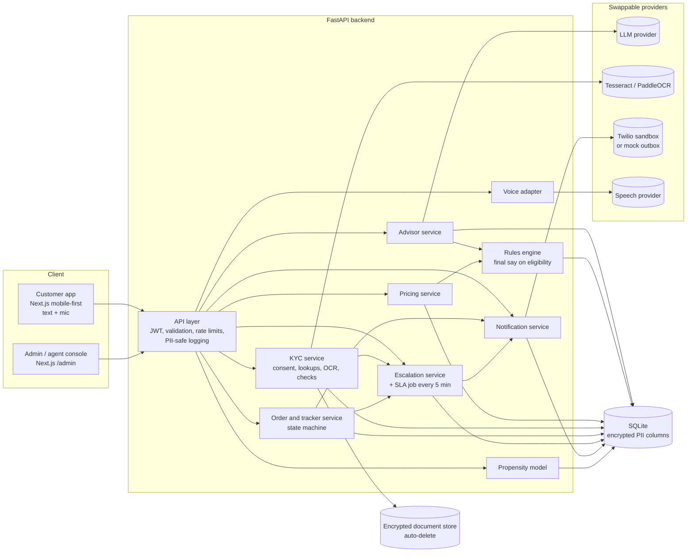
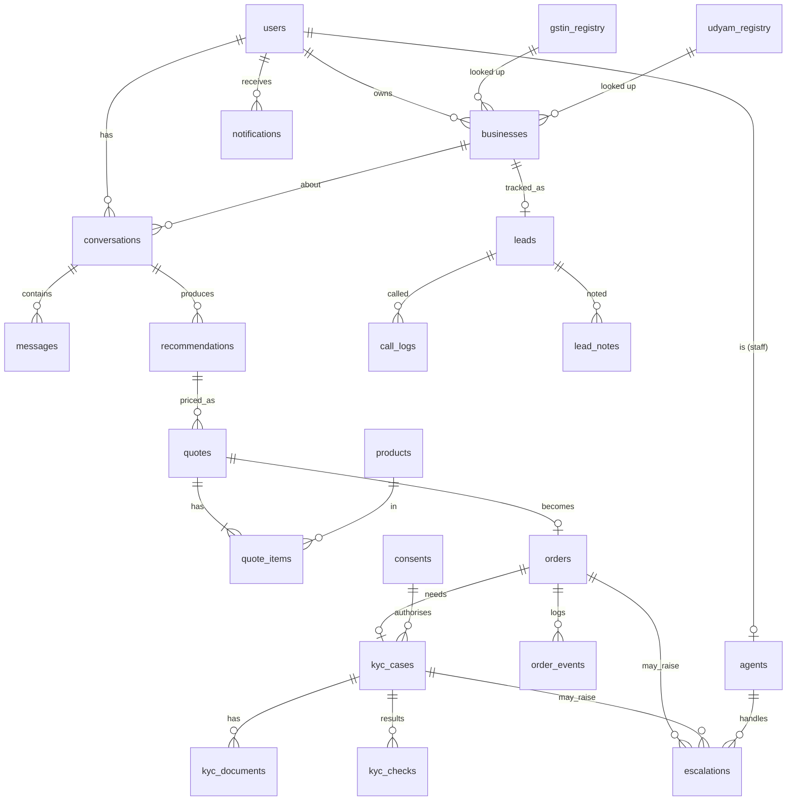
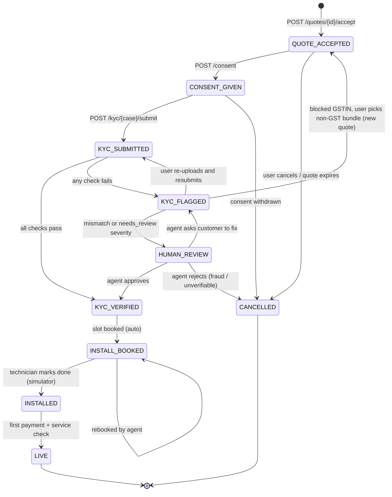

# Part B — Udyam Digital System Design (DESIGN.md)

This is the build specification for Phases 1–5. It is written before any production code. It follows from the Phase 1 report: every design choice below points back to a finding there, tagged the same way ([S], [F], [B], [M], [K]).

**Design principles**

1. **Rules decide, AI explains.** The language model runs the conversation and writes the "why". Eligibility, quantities and prices come only from deterministic code. Today 15% of sold bundles break catalogue rules [S], and the judges test eligibility live [Case].
2. **AI handles acquisition; humans handle exceptions.** Escalation is a first-class part of the system, not an afterthought. Half the KYC sample needed a fix or a review [K].
3. **Consent before KYC, minimum data, masked identifiers.** Required by the case and the DPDP Act 2023 [Case].
4. **The customer always sees their own status.** Chase calls track churn: 6% at 1 call, 28% at 5+ [S].
5. **Everything writes an event.** This keeps the five pilot metrics computable from the database [B].

**What already exists from Phase 1 and gets reused**

| Asset | Becomes |
|---|---|
| `analysis/validate_bundles.py` (`rule_errors`, `price`, `scale`) | `backend/app/rules/engine.py` and `backend/app/pricing/service.py` |
| `analysis/bundles.json` (4 validated starter bundles) | `backend/app/rules/bundles.json`, the advisor's default bundle per segment |
| `scripts/kyc_check.py` (watermark removal, deskew, blur check, GSTIN checksum repair, word-level name match, all cross-checks) | `backend/app/kyc/ocr.py` and `backend/app/kyc/checks.py` |
| `backend/app/propensity.py` + `backend/models/propensity.pkl` | Used as-is by the admin leads endpoints |
| 31 rules checks, 12 KYC verdicts | The first automated test suites |

# D1. Architecture

## D1.1 Components

| Component | Responsibility | Talks to |
|---|---|---|
| **Frontend (Next.js, Tailwind)** | Mobile-first customer app; admin/agent console under `/admin`; i18n for 7 languages (94.2% of leads [F]); browser speech APIs for voice | API over HTTPS (JSON + multipart) |
| **API gateway (FastAPI)** | Auth (JWT), routing, validation (Pydantic), rate limits, error format, PII-safe logging | All services (in-process modules for the hackathon) |
| **Advisor service** | Runs the conversation; builds the business profile; calls the rules engine; asks the LLM to explain only what the rules returned; counts failed turns | LLM provider interface, rules engine, DB |
| **Rules engine** | `eligible_products(profile)`, `validate_bundle(profile, items)`, `default_bundle(segment, profile)`. Pure functions, no I/O | Products table, `bundles.json` |
| **Pricing service** | Unit price rule, totals, setup fee, contract length, install days; recalculates on every toggle | Rules engine, products |
| **KYC service** | Consent records; GSTIN/Udyam mock lookups; upload storage; OCR pipeline; cross-checks; verdict | Registries, OCR engine, file store, escalation service |
| **Order & tracker service** | Order state machine, expected dates, tracker view, install simulator | Products (install days), notifications, escalation service |
| **Escalation service + job** | Creates escalations from triggers; least-loaded, language-matched assignment; SLA timers; periodic scan for overdue states | Orders, KYC, conversations, agents, notifications |
| **Notification service** | Templates per language; WhatsApp/SMS via Twilio sandbox or a mock outbox; opt-in enforced | Users, notifications table, provider |
| **Voice service** | Browser Web Speech API first; server adapter (Bhashini/Sarvam/other) behind `/voice/*` as fallback | Advisor |
| **Propensity model** | `predict(lead)` returns score, bucket and top 3 reasons [M] | Leads |
| **Admin dashboard** | Leads table with propensity, lead detail with call and notes, escalation queue, KYC review, metrics strip, notification outbox, order simulator | Admin endpoints |
| **Data stores** | SQLite (SQLAlchemy); encrypted file store for documents; no external database for the demo | — |

## D1.2 Architecture diagram



## D1.3 Main data flows

**1. Discovery to quote**

```
Customer message -> POST /advisor/message
  -> Advisor updates profile_json and asks the next question (max 6)
  -> when the profile is complete: rules.eligible_products(profile)
       + rules.default_bundle(segment) + products the owner asked for, if eligible
  -> rules.validate_bundle()  (must return no errors)
  -> LLM explains the validated items in the user's language
       (the prompt contains only validated items; the output is checked
        so it names no product_id outside the list)
  -> recommendation saved -> POST /quotes -> pricing.price(items)
```

**2. Quote to order**

```
Toggle add-on -> PATCH /quotes/{id}/items/{pid}
  -> validate_bundle; if removing an item breaks a dependency, it is locked with a reason
  -> totals recalculated -> POST /quotes/{id}/accept -> POST /orders (QUOTE_ACCEPTED)
```

**3. KYC**

```
POST /consent (purpose=kyc_verification) -> order CONSENT_GIVEN, kyc_case opened
-> GET /kyc/gstin/{gstin} (registry pre-fill; a cancelled/suspended GSTIN removes
   GST-only items, and the quote is re-priced)
-> POST /kyc/upload x4 (OCR runs on upload: blur, deskew, checksum repair)
-> POST /kyc/{case}/submit -> all cross-checks -> verdict
     Verified          -> KYC_VERIFIED
     Re-upload needed  -> KYC_FLAGGED, specific fix-it messages
     Human review      -> KYC_FLAGGED -> HUMAN_REVIEW + escalation
     Blocked           -> KYC_FLAGGED, offer non-GST bundle
```

**4. Fulfilment**

```
KYC_VERIFIED -> INSTALL_BOOKED (expected date = verified_at + max install days)
  -> INSTALLED -> LIVE
Every transition: order_event + notification (if opted in) + tracker update
SLA job: an overdue state creates an escalation, assigns an agent, notifies the user
```

**5. Admin**

```
GET /admin/leads -> leads + propensity bucket and reasons
  -> POST /admin/leads/{id}/call (call_log)
  -> POST /admin/leads/{id}/notes
GET /escalations -> agent picks up -> PATCH resolve -> order/KYC continues
```

## D1.4 Advisor guardrails (from the judges' 15 hidden scenarios)

- The LLM receives a tool schema and can only call `ask_question`, `set_profile_field`, `request_recommendation` or `handoff_to_human`.
- It never receives prices to invent. It receives the validated items and their prices from the pricing service.
- Every LLM reply is post-checked:
  - any product ID or price not in the validated set → reply discarded and regenerated;
  - after 2 failures → a template reply is used.
- A **failed turn** is any of the following. Two failed turns in one conversation trigger `advisor_failed` escalation:
  - the LLM's output fails validation twice;
  - the user repeats an answer the advisor couldn't parse;
  - the user says "talk to a person" (or the equivalent in their language).
- Ineligible requests always get a reason and what would unlock them (e.g. "WhatsApp Business needs an active GSTIN"). The 9 must-refuse cases from [B] become fixed test cases.
- The GSTIN question is asked early (question 2 or 3), because it gates 10 of 25 products and lifts activation from 2.0% to 9.6% [S][F].

# D2. Database schema (SQLite)

**Conventions**

- **Keys and timestamps.** Primary keys are `TEXT` UUIDv7 unless noted. Timestamps are ISO-8601 UTC `TEXT`. Money is `INTEGER` rupees. JSON is stored as `TEXT` (validated by Pydantic).
- **Personal data marking.** `PII` marks personal data. `[enc]` = encrypted with Fernet (AES-128-CBC + HMAC) using `APP_ENCRYPTION_KEY`. `[hash]` = HMAC-SHA256 with `PII_HASH_KEY`, used only for lookups. `[mask]` = a display-only masked copy, safe for UI and logs.
- **Masking formats:**

| Identifier | Masked form |
|---|---|
| Phone | `••••••4321` |
| GSTIN | `27•••••••••1Z5` (first 2 + last 3) |
| Udyam number | `UDYAM-MH-00-•••4567` |
| ID numbers | last 4 |
| Personal names in admin lists | first name + initial |

## D2.1 Identity and access

**users**

| Column | Type | Key / constraint | PII |
|---|---|---|---|
| id | TEXT | PK | |
| phone_enc | BLOB | NOT NULL | PII [enc] |
| phone_hash | TEXT | UNIQUE, NOT NULL | PII [hash] |
| phone_masked | TEXT | | [mask] |
| display_name_enc | BLOB | NULL | PII [enc] |
| role | TEXT | CHECK in (customer, agent, admin) | |
| language | TEXT | default 'hi' | |
| whatsapp_opt_in | INTEGER | 0/1, default 0 | |
| created_at, last_login_at | TEXT | | |

**otp_requests** (mock OTP)

| Column | Type | Key | PII |
|---|---|---|---|
| id | TEXT | PK | |
| phone_hash | TEXT | INDEX | PII [hash] |
| code_hash | TEXT | | (never the plain code) |
| expires_at | TEXT | | |
| attempts | INTEGER | max 5 | |
| consumed_at, created_at | TEXT | | |

**agents**

| Column | Type | Key | PII |
|---|---|---|---|
| id | TEXT | PK | |
| user_id | TEXT | FK → users.id, UNIQUE | |
| name | TEXT | | staff name (not customer PII) |
| languages | TEXT (JSON) | e.g. ["hi","en","ta"] | |
| skills | TEXT (JSON) | ["kyc","sales","install","account_manager"] | |
| max_open | INTEGER | default 8 | |
| active | INTEGER | 0/1 | |
| created_at | TEXT | | |

**audit_log**

| Column | Type | Key | PII |
|---|---|---|---|
| id | INTEGER | PK autoincrement | |
| actor_user_id | TEXT | FK → users.id | |
| action | TEXT | view_document, view_pii, resolve_escalation, call_lead, ... | |
| entity, entity_id | TEXT | | |
| created_at | TEXT | | |

## D2.2 Business, leads and reference data

**businesses**

| Column | Type | Key | PII |
|---|---|---|---|
| id | TEXT | PK | |
| user_id | TEXT | FK → users.id, INDEX | |
| name | TEXT | | business name (not personal) |
| business_type, segment | TEXT | segment CHECK in 4 values | |
| city, state | TEXT | | |
| city_tier | INTEGER | CHECK in (1,2) | |
| employees, sites | INTEGER | ≥ 1 | |
| turnover_band, current_internet, current_provider | TEXT | | |
| monthly_spend_inr | INTEGER | | |
| has_gstin | INTEGER | 0/1 | |
| gstin_enc | BLOB | | PII [enc] (proprietor GSTINs embed a personal PAN) |
| gstin_masked | TEXT | | [mask] |
| gst_status | TEXT | Active / Cancelled / Suspended / None | |
| has_udyam | INTEGER | | |
| udyam_enc / udyam_masked | BLOB / TEXT | | PII [enc] / [mask] |
| products_of_interest | TEXT (JSON) | | |
| lead_source, referral_code | TEXT | | |
| created_at, updated_at | TEXT | | |

**leads** (5,000 rows imported from `smb_leads.csv`, plus every new app lead)

| Column | Type | Key | PII |
|---|---|---|---|
| lead_id | TEXT | PK (L00001… for imports, L-APP-… for new) | |
| origin | TEXT | import / app | |
| business_id | TEXT | FK → businesses.id, NULL for imports | |
| *all CSV columns* | as in the CSV (dates TEXT, money INTEGER) | | contact_name is PII [mask] in UI; gstin/udyam_number [mask] in UI |
| propensity_score | REAL | | |
| propensity_bucket | TEXT | High / Medium / Low, INDEX | |
| propensity_reasons | TEXT (JSON) | top 3 | |
| advisor_outcome | TEXT | not_started / abandoned / escalated / quoted / ordered | |
| assigned_agent_id | TEXT | FK → agents.id | |
| last_contacted_at | TEXT | | |
| lead_status | TEXT | open / contacted / converted / closed | |

**products** (25 rows from `product_catalogue.csv`)

| Column | Type | Key |
|---|---|---|
| product_id | TEXT | PK (P01…P25) |
| category, name, description, unit | TEXT | |
| price_min_inr, price_max_inr, setup_fee_inr | INTEGER | |
| min_contract_months, min_employees, min_sites, install_days | INTEGER | |
| city_tiers | TEXT (JSON) | e.g. [1,2] |
| requires_gstin | INTEGER | 0/1 |
| requires_one_of | TEXT (JSON) | e.g. ["P01","P02","P03"] |
| target_segments | TEXT (JSON) | |
| quantity_basis | TEXT | per_site / per_user / fixed (from `bundles.json`) |

**gstin_registry** (3,534 rows)

| Column | Type | Key |
|---|---|---|
| gstin | TEXT | PK |
| legal_name, trade_name | TEXT | INDEX on lower(trade_name) |
| constitution, principal_place_of_business, state | TEXT | |
| registration_date | TEXT | |
| status | TEXT | Active / Cancelled / Suspended |

Synthetic, so stored in plain text. A real deployment would call the GSTN API rather than store it.

**udyam_registry** (2,723 rows)

| Column | Type | Key |
|---|---|---|
| udyam_number | TEXT | PK |
| enterprise_name | TEXT | INDEX (lower(enterprise_name), lower(city)) |
| enterprise_type, major_activity, nic_description, state, city | TEXT | |
| date_of_registration | TEXT | |

Composite index on name + city, because name-only lookups pick the wrong business [K].

## D2.3 Advisor

**conversations**

| Column | Type | Key | PII |
|---|---|---|---|
| id | TEXT | PK | |
| user_id | TEXT | FK → users.id | |
| business_id | TEXT | FK → businesses.id, NULL until the profile is saved | |
| lead_id | TEXT | FK → leads.lead_id | |
| language, channel | TEXT | channel: text / voice | |
| status | TEXT | active / recommended / escalated / abandoned | |
| profile_json | TEXT (JSON) | | GSTIN stored masked here |
| questions_asked | INTEGER | | |
| failed_turns | INTEGER | default 0; 2 triggers escalation | |
| created_at, updated_at | TEXT | | |

**messages**

| Column | Type | Key | PII |
|---|---|---|---|
| id | TEXT | PK | |
| conversation_id | TEXT | FK, INDEX | |
| role | TEXT | user / assistant / system / tool | |
| content | TEXT | | PII scrubbed before saving (regex for GSTIN, Udyam, phone, PAN replaced with masked forms) |
| modality | TEXT | text / voice | |
| audio_ref | TEXT | NULL | not stored by default |
| validation_status | TEXT | ok / regenerated / template | |
| created_at | TEXT | | |

**recommendations**

| Column | Type | Key |
|---|---|---|
| id | TEXT | PK |
| conversation_id | TEXT | FK |
| business_id | TEXT | FK |
| bundle_key | TEXT | micro / prof / multi / mfg / custom |
| items | TEXT (JSON) | [{product_id, qty, role: core/addon}] |
| blocked | TEXT (JSON) | [{product_id, reasons:[…]}] (asked for but ineligible) |
| explanation | TEXT | LLM text, in the user's language |
| rules_version | TEXT | git SHA of `rules/engine.py` + `bundles.json` |
| created_at | TEXT | |

## D2.4 Quotes and orders

**quotes**

| Column | Type | Key |
|---|---|---|
| id | TEXT | PK |
| business_id | TEXT | FK |
| recommendation_id | TEXT | FK |
| status | TEXT | draft / accepted / superseded / expired |
| monthly_total_inr, setup_total_inr | INTEGER | |
| contract_months, max_install_days | INTEGER | |
| pricing_rule | TEXT | "micro_min_v1" (micro: catalogue minimum) / "midpoint_v1" (others: rounded midpoint of min–max); see docs/PRICING.md |
| current_spend_inr | INTEGER | for the "vs what you pay now" line |
| valid_until | TEXT | created + 7 days |
| accepted_at, created_at | TEXT | |

**quote_items**

| Column | Type | Key |
|---|---|---|
| id | TEXT | PK |
| quote_id | TEXT | FK, INDEX; UNIQUE(quote_id, product_id) |
| product_id | TEXT | FK → products |
| qty | INTEGER | ≥ 1 |
| role | TEXT | core / addon |
| selected | INTEGER | 0/1 (add-on toggle) |
| unit_price_inr, line_monthly_inr, line_setup_inr | INTEGER | |
| locked | INTEGER | 0/1: can't be removed because another selected item depends on it |
| lock_reason | TEXT | e.g. "Static IP needs Biz Fibre" |

**orders**

| Column | Type | Key |
|---|---|---|
| id | TEXT | PK (human-friendly `UD-2607-0042` shown in UI) |
| quote_id | TEXT | FK, UNIQUE |
| business_id, user_id | TEXT | FK |
| state | TEXT | CHECK in the state list (D4), INDEX |
| state_entered_at | TEXT | |
| state_due_at | TEXT | SLA deadline for the current state, INDEX (scanned by the job) |
| expected_install_date, expected_live_date | TEXT | |
| install_slot | TEXT | e.g. "2026-07-21 10:00-12:00" |
| assigned_agent_id | TEXT | FK → agents (when escalated) |
| payment_status | TEXT | pending / paid / failed (mock gateway) |
| created_at, updated_at | TEXT | |

**order_events**

| Column | Type | Key |
|---|---|---|
| id | INTEGER | PK autoincrement |
| order_id | TEXT | FK, INDEX |
| from_state, to_state | TEXT | |
| actor | TEXT | system / user / agent:{id} / simulator |
| note | TEXT | |
| created_at | TEXT | |

## D2.5 Consent and KYC

**consents**

| Column | Type | Key | PII |
|---|---|---|---|
| id | TEXT | PK | |
| user_id | TEXT | FK | |
| business_id | TEXT | FK | |
| order_id | TEXT | FK, NULL for WhatsApp consent | |
| purpose | TEXT | kyc_verification / whatsapp_updates | |
| notice_version | TEXT | e.g. "kyc-v1.0" | |
| language | TEXT | | |
| granted | INTEGER | 0/1 | |
| granted_at, withdrawn_at | TEXT | | |
| client_hash | TEXT | | [hash] of IP + user agent (proof, not tracking) |

**kyc_cases**

| Column | Type | Key | PII |
|---|---|---|---|
| id | TEXT | PK | |
| order_id | TEXT | FK, UNIQUE | |
| business_id | TEXT | FK | |
| consent_id | TEXT | FK → consents.id, NOT NULL (no case without consent) | |
| status | TEXT | open / submitted / verified / flagged / human_review / rejected | |
| verdict | TEXT | Verified / Re-upload needed / Human review / Blocked | |
| gstin_enc, gstin_masked | BLOB / TEXT | | PII [enc] / [mask] |
| udyam_enc, udyam_masked | BLOB / TEXT | | PII [enc] / [mask] |
| registry_snapshot | TEXT (JSON) | trade name, status, state at check time | |
| retention_until | TEXT | verified_at + 90 days (or closed + 30 days if abandoned) | |
| created_at, submitted_at, verified_at | TEXT | | |

**kyc_documents**

| Column | Type | Key | PII |
|---|---|---|---|
| id | TEXT | PK | |
| case_id | TEXT | FK, INDEX; UNIQUE(case_id, doc_type, version) | |
| doc_type | TEXT | gst_certificate / udyam_certificate / signatory_id / address_proof | |
| version | INTEGER | re-uploads increment it | |
| storage_path_enc | BLOB | | PII [enc]; file itself encrypted at rest |
| sha256 | TEXT | duplicate/tamper check | |
| mime, size_bytes | TEXT / INTEGER | | |
| ocr_text_enc | BLOB | | PII [enc] |
| ocr_confidence, sharpness, skew_deg | REAL | | |
| extracted | TEXT (JSON) | | fields stored masked (names kept for matching, IDs masked) |
| status | TEXT | uploaded / processed / superseded / deleted | |
| uploaded_at, deleted_at | TEXT | | |

**kyc_checks**

| Column | Type | Key |
|---|---|---|
| id | INTEGER | PK autoincrement |
| case_id | TEXT | FK, INDEX |
| document_id | TEXT | FK, NULL for registry-only checks |
| check_code | TEXT | one of DOCUMENT_PRESENT, DOCUMENT_READABLE, GSTIN_FORMAT, GSTIN_MATCHES_CERTIFICATE, GSTIN_EXISTS, GSTIN_ACTIVE, GSTIN_STATE_CODE, UDYAM_EXISTS, UDYAM_NAME_MATCH, NAMES_MATCH, SIGNATORY_FOR_BUSINESS, ADDRESS_MATCH, ADDRESS_PROOF_DATE (see docs/KYC_CHECKS.md) |
| result | TEXT | pass / fail |
| severity | TEXT | blocking / unreadable / missing_document / stale / mismatch / confirm / needs_review / NULL |
| message_customer | TEXT | in the user's language, with a specific fix |
| detail_internal | TEXT | masked |
| created_at | TEXT | |

## D2.6 Operations

**escalations**

| Column | Type | Key |
|---|---|---|
| id | TEXT | PK |
| trigger | TEXT | sla_breach / kyc_flag / advisor_failed / user_request / assisted_deal |
| priority | TEXT | P1 / P2 / P3 |
| order_id, kyc_case_id, conversation_id, lead_id | TEXT | FKs, at least one NOT NULL (CHECK) |
| reason | TEXT | human-readable, masked |
| status | TEXT | open / assigned / in_progress / resolved / cancelled, INDEX |
| assigned_agent_id | TEXT | FK → agents |
| required_skill, language | TEXT | used for matching |
| sla_due_at | TEXT | first-response deadline |
| created_at, assigned_at, first_response_at, resolved_at | TEXT | |
| resolution | TEXT | approved / rejected / customer_contacted / rebooked / other |
| resolution_note | TEXT | |

UNIQUE(trigger, order_id) WHERE status not in (resolved, cancelled), to avoid duplicates.

**notifications**

| Column | Type | Key | PII |
|---|---|---|---|
| id | TEXT | PK | |
| user_id | TEXT | FK | |
| order_id | TEXT | FK, NULL | |
| channel | TEXT | whatsapp / sms / in_app | |
| template | TEXT | quote_ready, kyc_verified, kyc_fix_needed, kyc_review, install_booked, delay_escalated, live, kyc_reminder_24h, agent_assigned | |
| language | TEXT | | |
| payload | TEXT (JSON) | | masked values only |
| status | TEXT | queued / sent / delivered / failed / skipped_no_optin | |
| provider_ref, error | TEXT | | |
| created_at, sent_at | TEXT | | |

**call_logs**

| Column | Type | Key |
|---|---|---|
| id | TEXT | PK |
| lead_id | TEXT | FK, INDEX |
| agent_id | TEXT | FK |
| provider | TEXT | twilio / mock |
| outcome | TEXT | connected / no_answer / callback_requested / interested / converted / not_interested |
| duration_s | INTEGER | |
| provider_ref | TEXT | |
| created_at | TEXT | |

**lead_notes**

| Column | Type | Key |
|---|---|---|
| id | TEXT | PK |
| lead_id | TEXT | FK, INDEX |
| agent_id | TEXT | FK |
| body | TEXT | free text, PII-scrubbed on save |
| created_at | TEXT | |

## D2.7 Relationships



## D2.8 Data protection rules

| Rule | Implementation |
|---|---|
| Consent before KYC | `kyc_cases.consent_id NOT NULL`; `POST /kyc/upload` returns `403 CONSENT_REQUIRED` without an active consent |
| Data minimisation | Advisor stores no IDs except an optional GSTIN (masked in profile). KYC stores only the 4 required documents. Voice audio not stored |
| Encryption at rest | PII columns `[enc]`; document files encrypted with a per-file key wrapped by `APP_ENCRYPTION_KEY` |
| Masking in UI and logs | API serialisers return only `*_masked` fields. A logging filter redacts GSTIN, Udyam, PAN and phone patterns |
| Retention | Nightly job deletes document files and `ocr_text_enc` after `retention_until` (90 days after verification, 30 after abandonment) and sets `kyc_documents.status = deleted` |
| Access | Customer sees only their own records. Agents see assigned cases. Unmasked document view needs the agent or admin role and writes `audit_log` |
| Withdrawal | `DELETE /consent/{id}` stops processing, cancels any open KYC case and schedules deletion |

# D3. API contracts

**Base and auth:**

- Base URL: `/api/v1`.
- Send `Authorization: Bearer <jwt>` on every request except `auth/*`, `GET /products` and `GET /health`.
- JWT claims: `sub` (user id), `role`, `lang`, and a 24 h expiry.

**Error format, used everywhere:**

```json
{ "error": { "code": "GSTIN_INVALID", "message": "This GST number isn't valid. Please check it.", "details": { "field": "gstin" } } }
```

`message` is localised to the user's language.

**Common errors:**

| Status | Code |
|---|---|
| 400 | `VALIDATION_ERROR` |
| 401 | `UNAUTHENTICATED` |
| 403 | `FORBIDDEN` |
| 404 | `NOT_FOUND` |
| 409 | `INVALID_STATE` |
| 429 | `RATE_LIMITED` |
| 503 | `PROVIDER_UNAVAILABLE` (LLM, OCR or messaging down; the response carries a fallback) |

**Under each endpoint, "Tables"** lists what it reads (R) and writes (W).

## D3.1 Auth

### `POST /auth/otp/request`
Request `{ "phone": "+919876543210" }`

Response `200 { "request_id": "otp_01J…", "expires_in": 300, "dev_code": "123456" }`. `dev_code` is returned only when `OTP_MODE=mock`.

Errors: `400 PHONE_INVALID`, `429 RATE_LIMITED` (3 per 10 min per phone).

Tables: W `otp_requests`.

### `POST /auth/otp/verify`
Request `{ "request_id": "otp_01J…", "code": "123456", "language": "hi", "whatsapp_opt_in": true }`

Response `200 { "token": "<jwt>", "user": { "id": "usr_…", "role": "customer", "language": "hi", "phone_masked": "••••••3210", "whatsapp_opt_in": true } }`

Errors: `400 OTP_INVALID`, `410 OTP_EXPIRED`, `429 OTP_TOO_MANY_ATTEMPTS`.

Tables: R/W `otp_requests`; W `users` (created on first login); W `consents` (purpose `whatsapp_updates` when opted in).

### `GET /me` and `PATCH /me`
PATCH request `{ "language": "ta", "whatsapp_opt_in": false }`

Response `200 { "user": {…}, "business": { "id": "biz_…", "name": "…", "segment": "Professional offices", "gstin_masked": "27•••••••••1Z5" } | null }`

Tables: R/W `users`, `consents`; R `businesses`.

### `POST /auth/logout`
Response `204`. The token is added to a short-lived deny list (in memory).

Tables: none (no database write).

## D3.2 Advisor and voice

### `POST /advisor/conversations`
Starts or resumes a session.

Request `{ "language": "hi", "channel": "text", "lead_source": "WhatsApp campaign", "referral_code": null }`

Response `201 { "conversation_id": "cnv_…", "message": { "role": "assistant", "content": "नमस्ते! आपका व्यवसाय किस तरह का है?", "quick_replies": ["दुकान", "क्लिनिक / ऑफिस", "कई ब्रांच", "फैक्ट्री"] }, "resumed": false }`

Tables: W `conversations`, `messages`, `leads` (an app lead with `origin=app`).

### `POST /advisor/message`
Request `{ "conversation_id": "cnv_…", "content": "हमारी 2 ब्रांच हैं, 18 लोग", "modality": "voice" }`

Response `200`:

```json
{ "message": { "role": "assistant", "content": "ठीक है। क्या आपके पास GST नंबर है?", "quick_replies": ["हाँ", "नहीं"] },
  "profile": { "segment": "Small multi-site businesses", "employees": 18, "sites": 2, "city_tier": null, "has_gstin": null, "complete": false, "missing": ["city", "has_gstin", "needs"] },
  "status": "active", "failed_turns": 0, "escalation": null }
```

When the profile completes, `status` becomes `ready_to_recommend`. When `failed_turns` reaches 2 or the user asks for a person, `escalation` = `{ "id": "esc_…", "agent_name": "Priya", "eta": "16:00" }` and `status` = `escalated`.

Errors: `404 CONVERSATION_NOT_FOUND`, `409 CONVERSATION_CLOSED`, `503 PROVIDER_UNAVAILABLE` (a template question is returned instead).

Tables: R/W `conversations`, `messages`; W `escalations` (trigger `advisor_failed` / `user_request`), `notifications`.

### `POST /advisor/recommend`
Request `{ "conversation_id": "cnv_…" }`

Response `200`:

```json
{ "recommendation_id": "rec_…", "bundle_key": "prof",
  "items": [ { "product_id": "P02", "name": "Biz Fibre 300", "qty": 1, "role": "core", "why": "तेज़ इंटरनेट पूरे ऑफिस के लिए" } ],
  "addons": [ { "product_id": "P12", "name": "Cloud Telephony / SIP", "qty": 3, "why": "…" } ],
  "blocked": [ { "product_id": "P15", "name": "WhatsApp Business API Starter", "reasons": ["needs an active GSTIN"], "unlock": "Add your GST number to unlock this." } ],
  "explanation": "2-3 sentences in the user's language", "rules_version": "a1b2c3d" }
```

Errors: `409 PROFILE_INCOMPLETE` (with `missing`), `422 NO_ELIGIBLE_BUNDLE` (with the nearest valid option).

Tables: R `conversations`, `products`; W `recommendations`, `businesses` (profile saved), `messages`.

### `GET /advisor/conversations/{id}`
Response `200 { "conversation": {…}, "messages": [ … ], "recommendation": {…} | null }`

Tables: R `conversations`, `messages`, `recommendations`.

### `POST /voice/transcribe`
Server fallback. The browser Web Speech API is the default.

Request: multipart `audio` (webm/ogg, ≤ 30 s), `language`.

Response `200 { "text": "…", "confidence": 0.91 }`. Audio is processed in memory and not stored.

Errors: `413 AUDIO_TOO_LONG`, `503 PROVIDER_UNAVAILABLE`. Tables: none.

### `POST /voice/speak`
Request `{ "text": "…", "language": "hi" }`

Response `200 audio/mpeg`. Tables: none.

## D3.3 Products and quotes

### `GET /products`
Query: `?segment=prof&city_tier=2` (optional, filters by catalogue eligibility only).

Response `200 { "products": [ { "product_id": "P01", "name": "Biz Fibre 100", "category": "Connectivity", "unit": "per site", "price_min_inr": 999, "price_max_inr": 1199, "setup_fee_inr": 0, "min_contract_months": 12, "install_days": 5, "requires_gstin": false, "requires_one_of": [], "city_tiers": [1,2], "min_employees": 1, "min_sites": 1 } ] }`

Tables: R `products`.

### `GET /products/{id}`
Same shape, single item. `404 NOT_FOUND`. Tables: R `products`.

### `POST /quotes`
Create from a recommendation.

Request `{ "recommendation_id": "rec_…" }`

Response `201`:

```json
{ "quote_id": "quo_…", "status": "draft",
  "items": [ { "product_id": "P02", "name": "Biz Fibre 300", "qty": 1, "role": "core", "selected": true, "unit_price_inr": 1649, "line_monthly_inr": 1649, "line_setup_inr": 0, "locked": true, "lock_reason": "Needed by Static IP" } ],
  "monthly_total_inr": 6055, "setup_total_inr": 0, "contract_months": 12, "max_install_days": 5,
  "current_spend_inr": 2600, "valid_until": "2026-07-22" }
```

Errors: `404 RECOMMENDATION_NOT_FOUND`, `409 RECOMMENDATION_STALE` (rules version changed; re-recommend).

Tables: R `recommendations`, `products`, `businesses`; W `quotes`, `quote_items`.

### `GET /quotes/{id}`
Same shape as above. Tables: R `quotes`, `quote_items`, `products`.

### `PATCH /quotes/{id}`
Sets what the owner pays today, which feeds the "Compared with what you pay now" line. Added in build Phase 2, because the advisor is capped at 6 questions and doesn't ask about spend.

Request `{ "current_spend_inr": 2500 }`

Response `200`: the full quote, with `current_spend_inr` and `difference_inr` (= monthly total − current spend).

Errors: `400 VALIDATION_ERROR` (negative or above Rs 1 crore), `404 NOT_FOUND`.

Tables: W `quotes`, `businesses` (`monthly_spend_inr`), `leads` (`monthly_telecom_spend_inr`).

**Item rules (build Phase 2):**

- **What starts selected.** Core items from the recommendation start selected; add-ons start unselected.
- **What locks.** A selected item is locked, with `lock_reason`, if another selected item lists it in `requires_one_of` and no other selected item satisfies that dependency ("Needed by Static IP."). The only selected internet connection is also locked ("Every plan needs an internet connection."). Other core items can be switched off.
- **What re-runs.** Every change re-runs `validate_bundle` on the selected set.
- **Steppers.** Shown only for `per_site` items (1 to number of sites) and `per_user` items (1 to employees), and only when that range has more than one value.
- **Order on screen.** Items are listed core first, connection first.

### `PATCH /quotes/{id}/items/{product_id}`
Toggle an add-on or change quantity.

Request `{ "selected": false }` or `{ "qty": 4 }`

Response `200`: the full quote (same shape), recalculated.

Errors:

- `409 DEPENDENCY_LOCKED` (`details.reason`: "Static IP needs Biz Fibre")
- `422 INELIGIBLE` (`details.reasons` from the rules engine)
- `409 QUOTE_NOT_DRAFT`
- `422 QTY_NOT_EDITABLE` (fixed-quantity item), `422 QTY_OUT_OF_RANGE` (`details.min`, `details.max`)

Tables: R `products`, `businesses`; W `quote_items`, `quotes`.

### `POST /quotes/{id}/accept`
Request `{}`. Response `200 { "quote_id": "quo_…", "status": "accepted", "order_id": "ord_…" }`. This creates the order (same as `POST /orders`).

Errors: `409 QUOTE_EXPIRED`, `422 INELIGIBLE` (re-validated at accept time).

Tables: W `quotes`, `orders`, `order_events`, `notifications` (template `quote_ready`).

## D3.4 Orders and tracker

### `POST /orders`
Request `{ "quote_id": "quo_…" }`

Response `201 { "order_id": "ord_…", "display_id": "UD-2607-0042", "state": "QUOTE_ACCEPTED", "next_step": "consent" }`

Errors: `409 ORDER_EXISTS` (returns the existing id), `409 QUOTE_NOT_ACCEPTABLE`.

If the bundle is multi-site with SD-WAN, or a manufacturer with a leased line, the order is still created, and an `assisted_deal` escalation assigns an account manager.

Tables: R `quotes`; W `orders`, `order_events`, `escalations` (assisted deals).

### `GET /orders` and `GET /orders/{id}`
Response `200 { "orders": [ { "order_id": "…", "display_id": "…", "state": "INSTALL_BOOKED", "monthly_total_inr": 6055, "created_at": "…" } ] }`. The single-order form includes items and `kyc_case_id`.

Tables: R `orders`, `quotes`, `quote_items`, `kyc_cases`.

### `GET /orders/{id}/tracker`
Response `200`:

```json
{ "order_id": "ord_…", "state": "INSTALL_BOOKED",
  "steps": [
    { "key": "KYC_VERIFIED", "label": "Documents verified", "status": "done", "at": "2026-07-15T11:02:00Z" },
    { "key": "INSTALL_BOOKED", "label": "Installation booked", "status": "current", "at": "2026-07-15T11:05:00Z", "detail": "Technician visit 18 Jul, 10-12 am" },
    { "key": "INSTALLED", "label": "Installed", "status": "upcoming", "expected": "2026-07-18" },
    { "key": "LIVE", "label": "Live", "status": "upcoming", "expected": "2026-07-19" } ],
  "delayed": false,
  "escalation": { "id": "esc_…", "agent_name": "Priya", "message": "Priya from Accel will call you by 4 pm" } }
```

Build Phase 4 additions: `headline` (one plain sentence for the current state), `pre_verification`, `delay_message`, `next_action` (`consent` / `kyc` / null), `as_of`, and `late` on each step. Labels and details come back in `?language=` (default: the user's language). Before verification, INSTALLED and LIVE show "About N days after your documents are verified" instead of dates.

Tables: R `orders`, `order_events`, `escalations`, `agents`, `quote_items`, `products`, `kyc_cases`.

### `POST /orders/{id}/pay`
Mock gateway.

Request `{ "method": "upi" }`. Response `200 { "payment_status": "paid" }`.

Errors: `402 PAYMENT_FAILED` (simulated with `?fail=true`, which triggers a retry message).

Tables: W `orders`, `order_events`.

### `POST /admin/orders/{id}/advance`
Demo simulator; admin only.

Request `{ "to_state": "INSTALLED", "delay_hours": 0 }`. Either field may be left out. `delay_hours > 0` sets `state_due_at` that many hours in the past (back-dating `state_entered_at`, and for INSTALL_BOOKED moving the visit date back) so the next SLA scan fires. Advancing to INSTALL_BOOKED from INSTALL_BOOKED rebooks for the next working day. Advancing to LIVE marks the mock payment paid. The order may be given by id or display id. Also available from the command line: `python scripts/simulate.py UD-2611-0004 --late 30 --scan`.

Response `200 { "order_id": "…", "state": "INSTALLED" }`. Errors: `409 INVALID_TRANSITION`.

Tables: W `orders`, `order_events`, `notifications`.

## D3.5 Consent

### `GET /consent/notice`
Query `?purpose=kyc_verification&language=hi`

Response `200 { "notice_version": "kyc-v1.0", "title": "…", "sections": [ { "heading": "What we collect", "body": "GST certificate, Udyam certificate, signatory ID, address proof" }, { "heading": "Why", "body": "…" }, { "heading": "How long we keep it", "body": "90 days after verification, then deleted" }, { "heading": "Who can see it", "body": "…" }, { "heading": "Your rights", "body": "Withdraw any time…" } ] }`

Tables: none (versioned static content).

### `POST /consent`
Request `{ "purpose": "kyc_verification", "order_id": "ord_…", "notice_version": "kyc-v1.0", "granted": true }`

Response `201 { "consent_id": "cns_…", "kyc_case_id": "kyc_…", "order_state": "CONSENT_GIVEN" }`

Errors: `409 INVALID_STATE` (order not at QUOTE_ACCEPTED), `400 NOTICE_VERSION_OUTDATED`.

Tables: W `consents`, `kyc_cases`, `orders`, `order_events`.

### `DELETE /consent/{id}`
Withdraw consent.

Response `200 { "withdrawn_at": "…", "kyc_case_status": "rejected", "documents_scheduled_for_deletion": 4 }`

Tables: W `consents`, `kyc_cases`, `kyc_documents`, `orders`, `order_events`.

## D3.6 KYC

### `GET /kyc/gstin/{gstin}`
Response `200 { "gstin_masked": "27•••••••••1Z5", "valid_format": true, "checksum_ok": true, "found": true, "legal_name": "Neha Banerjee (Prop. Neelgiri Physio Clinic)", "trade_name": "Neelgiri Physio Clinic", "constitution": "Proprietorship", "state": "Delhi", "status": "Active", "effects": { "removed_products": [], "quote_repriced": false } }`

If `status` ≠ Active and a quote is in progress, GST-only items are removed, the quote is re-priced, and `effects` lists the changes.

Errors:

- `400 GSTIN_FORMAT` (not 15 characters / wrong pattern)
- `400 GSTIN_CHECKSUM` (check digit wrong; the validator accepts `X` as the 4th PAN character)
- `404 GSTIN_NOT_FOUND`

Tables: R `gstin_registry`; W `businesses` (`gstin_enc`, `gst_status`), `quote_items`/`quotes` (when repriced), `audit_log`.

### `GET /kyc/udyam/{num}`
Response `200 { "udyam_masked": "UDYAM-DL-00-•••4567", "found": true, "enterprise_name": "…", "enterprise_type": "Micro", "city": "New Delhi", "state": "Delhi", "matches_gst_trade_name": true, "matches_gst_state": true }`

Errors: `400 UDYAM_FORMAT` (must match `UDYAM-XX-00-NNNNNNN`; district `00` is accepted), `404 UDYAM_NOT_FOUND`.

Tables: R `udyam_registry`, `businesses`; W `businesses` (`udyam_enc`).

### `POST /kyc/upload`
Multipart: `case_id`, `doc_type`, `file` (jpg/png/pdf, ≤ 8 MB). OCR runs synchronously, in under about 5 s per page.

Response `201 { "document_id": "doc_…", "doc_type": "address_proof", "version": 2, "quality": { "sharpness": 412.3, "skew_corrected_deg": 0, "ocr_confidence": 92.1, "readable": true }, "extracted": { "bill_date": "2026-06-30", "billed_to": "Trinity Bake House Pvt Ltd" }, "instant_checks": [ { "check_code": "ADDRESS_PROOF_DATE", "result": "pass", "severity": null, "message": "Address proof is recent" } ] }`

Problems found on upload come back immediately as `instant_checks` failures with `message_customer`, so the user can fix them in the same session (e.g. "This photo is blurry…", "Your bill is from Oct 2025…").

Errors: `403 CONSENT_REQUIRED`, `409 CASE_NOT_OPEN`, `413 FILE_TOO_LARGE`, `415 UNSUPPORTED_TYPE`.

Instant checks are returned, not stored; the stored set in `kyc_checks` is the one written at submit.

Tables: R `kyc_cases`, `consents`, `gstin_registry`, `udyam_registry`; W `kyc_documents`, `kyc_cases` (masked identifiers).

### `POST /kyc/{case_id}/submit`
Request `{}`. Response `202 { "case_id": "kyc_…", "status": "submitted" }`. Checks run in a background task, in under about 10 s.

Errors: `409 DOCUMENTS_MISSING` only when nothing has been uploaded. A partly missing set is allowed through so the `DOCUMENT_PRESENT` rule can name what is missing (build Phase 3).

Tables: W `kyc_cases`, `orders` (KYC_SUBMITTED), `order_events`.

### `GET /kyc/{case_id}/result`
Response `200`:

```json
{ "case_id": "kyc_…", "status": "flagged", "verdict": "Re-upload needed",
  "checks": [ { "check_code": "ADDRESS_PROOF_DATE", "result": "fail", "severity": "stale", "message": "Your bill is dated 2025-10-31, 257 days ago. Please upload a bill from the last 90 days.", "action": { "type": "reupload", "doc_type": "address_proof" } } ],
  "order_state": "KYC_FLAGGED", "escalation": null }
```

The `verdict` mapping follows the verdicts in [K]:

| Verdict | Order state | Extra |
|---|---|---|
| Verified | KYC_VERIFIED | |
| Re-upload needed | KYC_FLAGGED | `action` set per check; P3 escalation so an agent can nudge |
| Human review | KYC_FLAGGED, then HUMAN_REVIEW | escalation returned |
| Blocked | KYC_FLAGGED | `action.type = "change_bundle"` |

Tables: R `kyc_cases`, `kyc_checks`, `orders`, `escalations`; W `orders`, `order_events`, `escalations`, `notifications`.

## D3.7 Escalations

### `POST /escalations`
The customer taps "Talk to a person".

Request `{ "order_id": "ord_…", "conversation_id": null, "reason": "Want to change installation date", "preferred_time": "after 4 pm" }`

Response `201 { "escalation_id": "esc_…", "status": "assigned", "agent": { "name": "Priya", "languages": ["hi","en"] }, "sla_due_at": "…", "message": "Priya from Accel will call you by 4 pm" }`

Errors: `409 ESCALATION_EXISTS` (returns the open one), `429 RATE_LIMITED`.

Tables: R `agents`, `escalations`; W `escalations`, `notifications`, `orders` (`assigned_agent_id`).

### `GET /escalations`
Agent or admin.

Query `?status=open,assigned&mine=true&trigger=kyc_flag`

Response `200 { "items": [ { "escalation_id": "…", "trigger": "kyc_flag", "priority": "P1", "status": "assigned", "business": "Saffron Unisex Salon", "reason": "GSTIN on certificate differs from registry", "order_display_id": "UD-2607-0042", "age_minutes": 37, "sla_due_at": "…", "agent": "Priya" } ], "counts": { "open": 3, "assigned": 5, "breached": 1 } }`

Tables: R `escalations`, `orders`, `businesses`, `agents`.

### `GET /escalations/{id}`
Response `200`: the escalation plus full context (masked profile, chat summary, quote, KYC checks, documents list with view links, order events). No customer has to repeat themselves.

Tables: R `escalations`, `conversations`, `messages`, `quotes`, `quote_items`, `kyc_cases`, `kyc_checks`, `kyc_documents`, `order_events`; W `audit_log`.

### `PATCH /escalations/{id}`
Request `{ "action": "assign" | "start" | "resolve" | "reassign", "agent_id": "agt_…", "resolution": "approved", "note": "Confirmed GSTIN with owner; typo on certificate" }`

Response `200`: the escalation. Resolving a `kyc_flag` with `approved` moves the order to KYC_VERIFIED. With `rejected`, the order goes back to KYC_FLAGGED with a message.

Errors: `409 INVALID_STATE`, `403 FORBIDDEN` (not assigned to you).

Tables: W `escalations`, `orders`, `order_events`, `kyc_cases`, `notifications`, `audit_log`.

### `GET /kyc/documents/{document_id}/view`
Agent/admin only. Returns a short-lived signed URL.

Response `200 { "url": "/files/…?sig=…", "expires_in": 120 }`

Tables: R `kyc_documents`; W `audit_log`.

## D3.8 Admin: leads, metrics, agents

### `GET /admin/leads`
Query `?bucket=High&status=open&advisor_outcome=abandoned,escalated&segment=prof&source=Website form&not_contacted=true&sort=-propensity_score&page=1&page_size=50`

Response `200 { "items": [ { "lead_id": "L00421", "business_name": "…", "contact": "Ritu S.", "segment": "Professional offices", "city": "Pune", "stage_reached": "Needs assessed", "drop_reason": null, "advisor_outcome": "abandoned", "propensity": { "score": 0.71, "bucket": "High", "bucket_conversion_pct": 15.9, "reasons": ["+ came via Referral", "+ has a GSTIN", "- tier 2 city"] }, "last_contacted_at": null } ], "total": 812 }`

Tables: R `leads`.

### `GET /admin/leads/{id}`
Response `200 { "lead": {…masked…}, "propensity": {…}, "conversation_summary": "…" | null, "quote": {…} | null, "calls": [ … ], "notes": [ … ] }`

Tables: R `leads`, `conversations`, `quotes`, `call_logs`, `lead_notes`; W `audit_log`.

### `POST /admin/leads/{id}/call`
Request `{ "mode": "twilio" | "mock" }`

Response `201 { "call_id": "call_…", "status": "ringing" | "logged" }`. The outcome is set later with `PATCH /admin/calls/{call_id}` and body `{ "outcome": "interested", "duration_s": 140 }`. "Interested" sends the advisor link by WhatsApp if the lead has opted in.

Errors: `409 RECENTLY_CALLED` (within 24 h), `503 PROVIDER_UNAVAILABLE` (falls back to mock).

Tables: R `leads`; W `call_logs`, `leads` (`last_contacted_at`, `lead_status`), `notifications`.

### `PATCH /admin/calls/{call_id}`
Request `{ "outcome": "interested", "duration_s": 140, "note": "Wants Office Pro, will finish KYC tonight" }`

Response `200 { "call_id": "call_…", "outcome": "interested", "lead_status": "contacted", "advisor_link_sent": true }`

Errors: `404 NOT_FOUND`, `400 VALIDATION_ERROR` (unknown outcome).

Tables: W `call_logs`, `leads`, `lead_notes` (if a note is given), `notifications`.

### `POST /admin/leads/{id}/notes`
Request `{ "body": "Owner busy until Monday, call after 5 pm" }`. Response `201 { "note_id": "…" }`. Tables: W `lead_notes`.

### `GET /admin/metrics`
Query `?from=2026-07-01&to=2026-07-31&segment=all&channel=self_serve|assisted|all`

Response `200`. Baselines come from [B]; `current` is computed from `orders`, `order_events`, `leads`, `call_logs` and `escalations`:

```json
{ "metrics": [
  { "key": "lead_to_activation", "baseline": 0.074, "target": 0.11, "current": 0.0 },
  { "key": "days_to_activate", "baseline": 17.6, "target": 8, "current": null },
  { "key": "cac_per_activation", "baseline": 15053, "target": 8000, "current": null },
  { "key": "churn_6m", "baseline": 0.152, "target": 0.11, "current": null },
  { "key": "chase_calls_per_customer", "baseline": 3.0, "target": 0.5, "current": null },
  { "key": "kyc_completion", "baseline": 0.683, "target": 0.85, "current": null },
  { "key": "escalation_resolution_hours", "baseline": null, "target": 24, "current": null } ] }
```

Tables: R `leads`, `orders`, `order_events`, `kyc_cases`, `escalations`, `notifications`.

### `GET /admin/orders`
Simulator order picker (build Phase 4). Response `200 { "orders": [ { "order_id": "…", "display_id": "UD-2611-0004", "state": "INSTALL_BOOKED", "business": "Shop in Lucknow", "state_due_at": "…", "allowed_next": ["INSTALLED","INSTALL_BOOKED"], "escalation": { "agent_name": "Arjun", "message": "…" } } ] }`

Tables: R `orders`, `businesses`, `escalations`, `agents`.

### `GET /admin/orders/{id}/events`
Simulator event log. Response `200 { "events": [ { "from": "KYC_VERIFIED", "to": "INSTALL_BOOKED", "actor": "system:fulfilment", "note": "…", "at": "…" } ] }`

Tables: R `order_events`.

### `POST /admin/sla/scan`
Runs the SLA scan once, now (the background job runs it every `SLA_SCAN_INTERVAL_SEC`). Response `200 { "actions": [ { "order_id": "…", "state": "INSTALL_BOOKED", "action": "escalated", "priority": "P1", "escalation_id": "…" } ] }`. Actions: `reminder`, `escalated`, `raised_priority`, `cancelled`.

Tables: R `orders`; W `escalations`, `notifications`, `orders`, `order_events`.

### `GET /admin/agents`
Response `200 { "agents": [ { "id": "agt_…", "name": "Priya", "languages": ["hi","en"], "skills": ["kyc","sales"], "open_cases": 3, "max_open": 8 } ] }`

Tables: R `agents`, `escalations`.

## D3.9 Notifications

### `POST /notifications/whatsapp`
Internal or admin send, used by services and for demo resends.

Request `{ "user_id": "usr_…", "order_id": "ord_…", "template": "install_booked", "language": "hi", "params": { "date": "18 Jul", "slot": "10-12 am" } }`

Response `202 { "notification_id": "ntf_…", "status": "queued" | "skipped_no_optin" }`

Errors: `404 TEMPLATE_NOT_FOUND`, `422 PARAMS_MISSING`.

Tables: R `users`, `consents`; W `notifications`.

### `GET /notifications`
The customer sees their own messages; the admin sees the outbox (`?scope=all`).

Response `200 { "items": [ { "id": "…", "channel": "whatsapp", "template": "kyc_fix_needed", "status": "sent", "preview": "Your bill is older than 3 months…", "created_at": "…" } ] }`

Tables: R `notifications`.

### `POST /notifications/webhook/twilio`
Delivery status callback, validated by the Twilio signature.

Request: form-encoded Twilio payload. Response `204`.

Tables: W `notifications`.

## D3.10 System

| Endpoint | Purpose | Tables |
|---|---|---|
| `GET /health` | Liveness, DB check, provider status (LLM, OCR, messaging: up / degraded / mock) | R `products` (count) |
| `POST /admin/seed` (dev only) | Loads the 4 CSVs, 5 agents and demo users | W `products`, `leads`, `gstin_registry`, `udyam_registry`, `agents`, `users` |

# D4. Order state machine and escalation rules

## D4.1 States and transitions



**Rules:**

- **Invalid transitions** return `409 INVALID_TRANSITION`.
- **Every transition writes three things:** an `order_events` row, an updated `orders.state_entered_at`, and a recomputed `state_due_at`. It also queues the matching notification, if the user has opted in.
- **Blocked GSTIN.** The `KYC_FLAGGED → QUOTE_ACCEPTED` path for a blocked GSTIN supersedes the old quote and creates a new one without GST-only products. The KYC documents already uploaded are kept.

## D4.2 Expected dates

| Date | Formula | Example (Office Pro) |
|---|---|---|
| `expected_install_date` | `kyc_verified_at` + max(`install_days` of selected items) | P02 5 d, P08 1 d, P16 1 d, P20 1 d, P17 1 d → +5 days |
| `expected_live_date` | `expected_install_date` + 1 day | +6 days from verification |
| Shown before purchase | On the quote, as "Live in about N days after documents are verified" | N = 6 |

Install days come from `typical_install_days` in the catalogue. Examples:

- Dukaan Digital: 5 days, or 2 with the AirFiber fallback
- Factory Line: 21 days (leased line)
- SD-WAN add-on: 14 days

These are the dates the tracker shows. The target of 8 days from lead to live [B] is only reachable when the install takes 5 days or less. This is one more reason to launch with professional offices.

## D4.3 SLA per state (what "late by X hours" means)

| State | Expected duration | Late after | Action when late |
|---|---|---|---|
| QUOTE_ACCEPTED (waiting for consent) | minutes | 24 h | Reminder (`kyc_reminder_24h`), no escalation. At 7 days, quote expires → CANCELLED |
| CONSENT_GIVEN (waiting for uploads) | minutes | 24 h, then 72 h | Reminder at 24 h. At 72 h, escalation `sla_breach` P3 (agent offers help) |
| KYC_SUBMITTED | under 10 seconds | 1 h | Escalation `sla_breach` P1 (pipeline stuck) |
| KYC_FLAGGED (waiting for re-upload) | — | 48 h | Reminder at 24 h; escalation P3 at 48 h |
| HUMAN_REVIEW | — | 4 business hours to first response | Escalation is created on entry; breach raises priority to P1 and alerts the admin |
| KYC_VERIFIED (waiting for slot) | instant (auto) | 24 h | Escalation P2 |
| INSTALL_BOOKED | until `expected_install_date` | expected_install_date + 24 h | Escalation `sla_breach` P1; customer told "Priya will call you by …" |
| INSTALLED (waiting for live) | 1 day | 48 h | Escalation P2 |

The SLA job runs every `SLA_SCAN_INTERVAL_SEC` (default 300, set to 5 for the demo) as an asyncio task started with the API, so there is no extra scheduler dependency. It selects orders where `state_due_at < now`, not LIVE or CANCELLED, and acts once per breach:

- **Reminder first** for QUOTE_ACCEPTED, CONSENT_GIVEN and KYC_FLAGGED, then `state_due_at` moves to the second deadline (7 days, 72 h, 48 h after entering the state).
- **No duplicates.** Nothing new is created while the order has an open `sla_breach`. In KYC states, an open `kyc_flag` counts too; for HUMAN_REVIEW its priority is raised to P1 instead.
- **INSTALL_BOOKED is late** 24 h after the end of the booked visit window on `expected_install_date`.
- **Fulfilment breaches** also send `delay_escalated`, and the tracker shows the delay banner and the agent.

**Callback promises.** "Priya will call you by …" is computed inside working hours, Mon–Sat 09:00–19:00 IST, rounded up to 15 minutes: P1 in 2 working hours, P2 in 4, P3 in 24. A request at 18:50 on Saturday is promised for 11 am Monday. The date is shown when it isn't today.

**Booking.** KYC_VERIFIED → INSTALL_BOOKED happens straight away (`system:fulfilment`): the visit date is the verification date plus the longest `install_days` in the bundle (moved off Sundays), in one of four 2-hour slots.

## D4.4 Escalation triggers and assignment

| Trigger | Fires when | Priority | Required skill |
|---|---|---|---|
| `sla_breach` | Any row in D4.3 crosses its "late after" | per table | install (fulfilment states), kyc (KYC states) |
| `kyc_flag` | Verdict = Human review (severity `mismatch` / `needs_review`), e.g. K06 GSTIN differs, K07 name names another business [K] | P1 | kyc |
| `advisor_failed` | `conversations.failed_turns` reaches 2 | P2 | sales |
| `user_request` | `POST /escalations`, or the user says they want a person in chat | P2 | sales (pre-order) / install (post-order) |
| `assisted_deal` | Order contains SD-WAN (P10), a leased line (P05/P06), or 3+ sites | P2 | account_manager |

**Assignment algorithm:**

1. Filter to `agents.active = 1` with the required skill.
2. Prefer agents whose `languages` include the customer's language.
3. Pick the agent with the fewest open escalations, as long as they're below `max_open`.
4. Break ties by the oldest `assigned_at`.
5. If no agent qualifies, leave the escalation `open` (unassigned) and show it at the top of the admin queue.

On assignment:

- Set `escalations.assigned_agent_id` and `sla_due_at`.
- Set `orders.assigned_agent_id`, if there is an order.
- Send the customer `agent_assigned` (WhatsApp if opted in, plus an in-app banner on the tracker).

## D4.5 Notifications per event

| Event | Template | Channel |
|---|---|---|
| Quote accepted | `quote_ready` | in_app + WhatsApp |
| Incomplete KYC after 24 h | `kyc_reminder_24h` | WhatsApp (opt-in only) |
| KYC verified | `kyc_verified` | in_app + WhatsApp |
| KYC needs a fix | `kyc_fix_needed` (lists the exact fix) | in_app + WhatsApp |
| KYC in human review | `kyc_review` | in_app + WhatsApp |
| Install booked | `install_booked` (date, slot) | in_app + WhatsApp |
| Delay or escalation | `delay_escalated` / `agent_assigned` | in_app + WhatsApp |
| Live | `live` | in_app + WhatsApp |

When the user hasn't opted in, WhatsApp messages are recorded with status `skipped_no_optin`, and the in-app message still shows.

# D5. Screen-by-screen UI plan

**Layout and theme.** Mobile-first at a 360 px width, with a desktop admin console. The theme is Accel Business red and white, with large tap targets of at least 44 px. The real Airtel logo or name is never shown in the product UI.

**Components.** These names are used in the frontend folder (D6):

- `ChatBubble`
- `QuickReplies`
- `MicButton`
- `BundleCard`
- `PriceBar`
- `AddonToggle`
- `StepTimeline`
- `UploadTile`
- `CheckResult`
- `HumanBanner`
- `DataTable`
- `PropensityBadge`
- `MetricTile`

## D5.1 Customer screens

### C1. Language pick (`/`)
- **Purpose:** choose the language first, so every following word is understood.
- **Components:** 7 language tiles (हिंदी, English, मराठी, ಕನ್ನಡ, ગુજરાતી, తెలుగు, தமிழ்), auto-highlighting the browser language.
- **API calls:** none. Saved locally, then sent at login. `PATCH /me` if already logged in.
- **Empty/error states:** none. Defaults to Hindi if nothing is chosen.

### C2. Login (`/login`)
- **Purpose:** identify the owner with the least friction.
- **Components:** phone input (+91), "Send OTP", 6-box OTP input, WhatsApp opt-in checkbox ("Send me updates on WhatsApp"), link to the privacy summary.
- **API calls:** `POST /auth/otp/request`, `POST /auth/otp/verify`.
- **Empty/error states:** invalid phone (inline); wrong OTP (shake, attempts left); expired OTP ("Resend"); rate limited ("Try again in 10 minutes"). In mock mode, the dev code is shown in a banner.

### C3. Advisor chat (`/advisor`)
- **Purpose:** discover the business in 5–6 questions, by text or voice.
- **Components:**
  - `ChatBubble` list
  - `QuickReplies` chips for common answers
  - `MicButton` (hold to talk, shows the live transcript)
  - progress dots ("question 3 of 6")
  - "Talk to a person" link in the header
  - read-aloud toggle
- **API calls:**
  - `POST /advisor/conversations`
  - `POST /advisor/message`
  - `POST /voice/transcribe` and `POST /voice/speak`, only when browser speech is unavailable
  - `GET /advisor/conversations/{id}` (resume)
- **Empty/error states:**
  - First visit shows a greeting and the first question.
  - Mic permission denied → "Type instead" hint.
  - LLM unavailable → the template question flow continues, invisible to the user.
  - Two failed turns → `HumanBanner` "Priya will call you by 4 pm", and the chat stays open.
  - Network loss → message queued with a retry chip.

### C4. Recommendation card (`/advisor/recommendation`)
- **Purpose:** show the bundle and why it fits, in plain words, with no product codes.
- **Components:**
  - `BundleCard` (each item with an icon, name, one-line "why", quantity)
  - "Not available yet" section for blocked items, with the unlock reason (e.g. "Add your GST number to unlock WhatsApp Business")
  - explanation paragraph
  - "See price" button
- **API calls:** `POST /advisor/recommend`, `POST /quotes`.
- **Empty/error states:**
  - `PROFILE_INCOMPLETE` → back to chat with the missing question.
  - `NO_ELIGIBLE_BUNDLE` → nearest valid option plus a "Talk to a person" offer.

### C5. Quote with add-on toggles (`/quote/[id]`)
- **Purpose:** one clear monthly price the owner can shape. This targets the 43.6% quote step [F].
- **Components:**
  - sticky `PriceBar` (monthly total, setup fee, contract months)
  - core items (locked, with a lock reason on tap)
  - `AddonToggle` list with price deltas
  - quantity steppers for per-site and per-user items
  - "Compared with what you pay now" line. If the spend isn't known, the owner picks a chip (Rs 500 / 1,000 / 2,500 / 5,000 / 10,000) or types an amount, sent with `PATCH /quotes/{id}`
  - "Live in about N days" line
  - the total updates on screen the moment a toggle or stepper is tapped (computed in the browser from the unit prices), then is confirmed by the server; if the server rejects the change, it rolls back and shows the reason
  - "Accept" button
- **API calls:** `GET /quotes/{id}`, `PATCH /quotes/{id}/items/{pid}`, `PATCH /quotes/{id}`, `POST /quotes/{id}/accept`.
- **Empty/error states:**
  - `DEPENDENCY_LOCKED` → toast with the reason.
  - `INELIGIBLE` → toggle reverts with the reason.
  - `QUOTE_EXPIRED` → "Prices refreshed" and reload.
  - Assisted deal → banner "An account manager will confirm your site survey".

### C6. Consent (`/order/[id]/consent`)
- **Purpose:** informed consent before any document is collected (DPDP).
- **Components:** notice sections (what, why, how long, who sees it, your rights), "I agree" checkbox, "Continue" button, "Not now" button.
- **API calls:** `GET /consent/notice`, `POST /consent`.
- **Empty/error states:**
  - "Not now" → saved; reminder after 24 h if opted in.
  - `NOTICE_VERSION_OUTDATED` → reload the notice.

### C7. KYC (`/order/[id]/kyc`)
A three-step stepper.

**C7a. GSTIN**
- **Components:** GSTIN input with live format and checksum validation; "I don't have GST" link; registry result card (masked GSTIN, trade name, status). Udyam number input, optional.
- **API calls:** `GET /kyc/gstin/{gstin}`, `GET /kyc/udyam/{num}`.
- **Errors:**
  - Format or checksum error inline.
  - Not found → "Check the number or upload your certificate".
  - Cancelled or suspended → explainer plus the re-priced bundle without GST-only items.

**C7b. Uploads**
- **Components:** 4 `UploadTile`s (camera or file) with instant quality feedback. The Udyam tile is hidden when `has_udyam=false`.
- **API calls:** `POST /kyc/upload` per document.
- **Errors:**
  - Blurry → "Retake in good light".
  - Stale bill → "Upload a bill from the last 3 months".
  - Too large or wrong type → inline message.
  - Consent missing → back to C6.

**C7c. Results**
- **Components:** `CheckResult` list (green ticks, fix-it items with a re-upload button), overall verdict.
- **API calls:** `POST /kyc/{case}/submit`, then `GET /kyc/{case}/result` (polled every 2 s until done).
- **Empty/error states:**
  - Submitting → "Checking your documents…" (under 10 s).
  - Human review → `HumanBanner` "A specialist will check this with you by …".
  - Blocked → "Choose a plan that doesn't need GST" → new quote.

### C8. Order placed (`/order/[id]/placed`)
- **Purpose:** confirm the order and take the first payment (mock).
- **Components:** order number, bundle summary, expected install and live dates, "Pay Rs X" (UPI/card mock), "Track my order" button.
- **API calls:** `GET /orders/{id}`, `POST /orders/{id}/pay`.
- **Empty/error states:** `PAYMENT_FAILED` → retry with an alternative method; leaving the screen keeps the payment pending, with a tracker reminder.

### C9. Tracker (`/order/[id]`)
This is the home screen after purchase.

- **Purpose:** remove the need to chase. Churn runs 6% at 1 chase call vs 28% at 5+ [S].
- **Components:**
  - `StepTimeline` (Verified → Installation booked → Installed → Live) with done/current/upcoming states, actual and expected dates
  - plain-language detail ("Technician visit 18 Jul, 10–12 am")
  - delay banner
  - `HumanBanner` with the agent's name when escalated
  - "Talk to a person" button
  - WhatsApp updates toggle
- **API calls:** `GET /orders/{id}/tracker` (on open, then every 60 s), `GET /orders`, `GET /notifications`.
- **Empty/error states:**
  - No orders → "Start with the advisor".
  - Offline → last known status with a timestamp.
  - Delayed → amber banner plus the assigned agent's name.

### C10. Talk to a person (bottom sheet, available from C3, C5, C7, C9)
- **Purpose:** an explicit human path at any point.
- **Components:** reason picker (pre-filled from context), preferred time, language, "Request call" button; then a confirmation card with the agent's name and ETA.
- **API calls:** `POST /escalations`.
- **Empty/error states:**
  - `ESCALATION_EXISTS` → show the existing one.
  - No agent free → "We'll call you by tomorrow 11 am" (open queue).

## D5.2 Admin and agent screens (`/admin`, desktop-first)

### A1. Admin login
- **Purpose:** staff access.
- **Components:** the same OTP form; role checked.
- **API calls:** `POST /auth/otp/request`, `POST /auth/otp/verify`, `GET /me`.
- **Errors:** `FORBIDDEN` for customer accounts.

### A2. Leads table (`/admin/leads`)
- **Purpose:** decide whom to call first. The top 20% of leads hold 43% of activations [M].
- **Components:**
  - filter row: bucket, segment, source, advisor outcome, "not contacted", date range
  - `DataTable` sorted by propensity, with a `PropensityBadge` (bucket + "converts ~15.9%") and top 3 reasons on hover
  - masked contact
  - metric strip of 5 `MetricTile`s (baseline → target → current)
- **API calls:** `GET /admin/leads`, `GET /admin/metrics`.
- **Empty/error states:** no matches → "No leads match these filters" with a reset button; metrics with no app data yet → "—" with "baseline from Apr–Jun 2026".

### A3. Lead detail (`/admin/leads/[id]`)
- **Purpose:** call with context and record the outcome.
- **Components:** profile card (masked), propensity with reasons, chat summary and abandoned quote (if any), "Call" button, outcome picker, notes list with an add-note box, call history.
- **API calls:** `GET /admin/leads/{id}`, `POST /admin/leads/{id}/call`, `PATCH /admin/calls/{call_id}`, `POST /admin/leads/{id}/notes`.
- **Empty/error states:**
  - `RECENTLY_CALLED` → "Called 3 h ago by Priya".
  - Call provider down → mock call logged with a notice.
  - No conversation → "Imported lead, no app activity".

### A4. Escalations queue (`/admin/escalations`)
- **Purpose:** humans handle exceptions.
- **Components:** tabs (Mine, Open, All), list with trigger icon, priority, SLA countdown (red when breached), business, reason, agent; "Assign to me" and reassign actions.
- **API calls:** `GET /escalations`, `PATCH /escalations/{id}` (assign/reassign), `GET /admin/agents`.
- **Empty/error states:** empty → "No open escalations" (a good state); breached items are pinned to the top.

### A5. Escalation / KYC review detail (`/admin/escalations/[id]`)
- **Purpose:** resolve a case without making the customer repeat anything.
- **Components:**
  - context panel: profile, chat summary, quote, order timeline
  - KYC checks with severities
  - document viewer (signed URL, audit-logged)
  - side-by-side "certificate says / registry says" for mismatches (K06, K07)
  - resolution buttons (Approve, Ask customer to fix, Reject, Rebook install) with a required note
- **API calls:** `GET /escalations/{id}`, `GET /kyc/documents/{id}/view`, `PATCH /escalations/{id}`.
- **Empty/error states:** document deleted after retention → "Document deleted on [date] (retention)"; `INVALID_STATE` → refresh.

### A6. Notifications outbox (`/admin/notifications`)
- **Purpose:** show in the demo that messages went out, even in mock mode.
- **Components:** table of channel, template, status, preview, time; "Resend" action.
- **API calls:** `GET /notifications?scope=all`, `POST /notifications/whatsapp`.
- **Empty/error states:** empty → "No messages yet"; failed rows in red with the error text.

**Staff console language (build Phase 4).** The A-screens are in English. Customer-facing text an agent needs to see ("Customer was told: …") is shown as the customer saw it.

### A7. Order simulator (`/admin/simulator`)
Demo only.

- **Purpose:** move orders through states and create delays on cue for the demo video.
- **Components:** order picker, "Advance to…" buttons, "Make it late by N hours" input, live event log.
- **API calls:** `GET /admin/orders`, `GET /admin/orders/{id}/events`, `POST /admin/orders/{id}/advance`, `POST /admin/sla/scan`, `GET /orders/{id}/tracker`.
- **Empty/error states:** `INVALID_TRANSITION` → shows the allowed next states.

# D6. Folder structure and environment

## D6.1 Repository layout

```
udyam-digital/
├── data/                         # supplied CSVs + kyc_documents/ (git-ignored in public repo)
├── analysis/                     # Phase 1 scripts and outputs (already done)
├── docs/                         # PHASE_1 report, DESIGN.md, figures/, privacy note, deck
├── backend/
│   ├── pyproject.toml
│   ├── alembic/                  # migrations (or create_all for the demo)
│   ├── models/propensity.pkl
│   ├── app/
│   │   ├── main.py               # FastAPI app, routers, middleware
│   │   ├── config.py             # pydantic-settings, reads env
│   │   ├── db.py                 # engine, session
│   │   ├── security/             # jwt.py, crypto.py (Fernet, HMAC), masking.py, log_filter.py
│   │   ├── models/               # SQLAlchemy: user.py, business.py, lead.py, product.py, registry.py,
│   │   │                         #   conversation.py, recommendation.py, quote.py, order.py,
│   │   │                         #   consent.py, kyc.py, escalation.py, notification.py, call.py, audit.py
│   │   ├── schemas/              # Pydantic request/response models per router
│   │   ├── routers/              # auth.py, advisor.py, voice.py, products.py, quotes.py, orders.py,
│   │   │                         #   consent.py, kyc.py, escalations.py, admin.py, notifications.py, health.py
│   │   ├── rules/                # engine.py (from validate_bundles.py), bundles.json
│   │   ├── pricing/service.py
│   │   ├── advisor/              # orchestrator.py, prompts/, llm/ (base.py, provider adapters), guards.py
│   │   ├── kyc/                  # ocr.py, gstin.py (checksum + repair), checks.py, names.py, storage.py
│   │   ├── orders/               # state_machine.py, tracker.py, dates.py
│   │   ├── escalations/          # triggers.py, assign.py, sla_job.py
│   │   ├── notifications/        # service.py, templates/{hi,en,mr,kn,gu,te,ta}.json, providers/ (twilio.py, mock.py)
│   │   ├── voice/                # base.py, providers/
│   │   ├── propensity.py
│   │   └── seed.py               # loads CSVs, agents, demo users
│   └── tests/
│       ├── test_rules.py         # 22 bundle checks + 9 must-refuse (from Phase 1)
│       ├── test_pricing.py
│       ├── test_gstin.py         # checksum, 'X' 4th PAN char, repair
│       ├── test_kyc_applicants.py# K01–K12 expected verdicts
│       ├── test_state_machine.py
│       ├── test_escalations.py
│       ├── test_advisor_scenarios.py  # our 15 judge-style scenarios
│       └── test_privacy.py       # no raw IDs in logs/responses
└── frontend/
    ├── package.json
    ├── next.config.js
    ├── tailwind.config.ts        # Accel red/white tokens
    ├── messages/                 # hi.json, en.json, mr.json, kn.json, gu.json, te.json, ta.json
    ├── public/                   # icons, illustrations (no third-party logos)
    ├── src/
    │   ├── app/
    │   │   ├── page.tsx                      # C1 language
    │   │   ├── login/page.tsx                # C2
    │   │   ├── advisor/page.tsx              # C3
    │   │   ├── advisor/recommendation/page.tsx # C4
    │   │   ├── quote/[id]/page.tsx           # C5
    │   │   ├── order/[id]/consent/page.tsx   # C6
    │   │   ├── order/[id]/kyc/page.tsx       # C7a-c
    │   │   ├── order/[id]/placed/page.tsx    # C8
    │   │   ├── order/[id]/page.tsx           # C9 tracker
    │   │   └── admin/
    │   │       ├── login/page.tsx            # A1
    │   │       ├── leads/page.tsx            # A2
    │   │       ├── leads/[id]/page.tsx       # A3
    │   │       ├── escalations/page.tsx      # A4
    │   │       ├── escalations/[id]/page.tsx # A5
    │   │       ├── notifications/page.tsx    # A6
    │   │       └── simulator/page.tsx        # A7
    │   ├── components/           # ChatBubble, QuickReplies, MicButton, BundleCard, PriceBar, AddonToggle,
    │   │                         #   StepTimeline, UploadTile, CheckResult, HumanBanner, TalkToPersonSheet (C10),
    │   │                         #   DataTable, PropensityBadge, MetricTile
    │   ├── lib/                  # api.ts (typed client), auth.ts, speech.ts, i18n.ts, format.ts (Rs, dates)
    │   └── types/                # generated from FastAPI OpenAPI schema
    └── tests/e2e/                # Playwright happy path on a 360 px viewport
```

## D6.2 Environment variables

| Variable | Used by | Example / note |
|---|---|---|
| `APP_ENV` | backend | `dev` / `demo` / `prod` |
| `DATABASE_URL` | backend | `sqlite:///./udyam.db` |
| `JWT_SECRET`, `JWT_EXPIRES_MIN` | backend | random 32+ bytes; `1440` |
| `APP_ENCRYPTION_KEY` | backend | Fernet key for PII columns and document keys |
| `PII_HASH_KEY` | backend | HMAC key for `phone_hash` / `client_hash` |
| `OTP_MODE` | backend | `mock` (returns `dev_code`) / `sms` |
| `CORS_ORIGINS` | backend | `http://localhost:3000,https://<frontend>.vercel.app` |
| `LLM_PROVIDER`, `LLM_MODEL`, `LLM_API_KEY` | advisor | provider adapter; `LLM_PROVIDER=template` runs without an LLM |
| `LLM_TIMEOUT_S`, `ADVISOR_MAX_QUESTIONS`, `ADVISOR_MAX_FAILED_TURNS` | advisor | `8`, `6`, `2` |
| `OCR_ENGINE`, `TESSERACT_CMD` | KYC | `tesseract` / `paddle`; binary path |
| `KYC_TODAY` | KYC | `2026-07-15` (fixed "today" for the dataset's date checks) |
| `KYC_ADDRESS_PROOF_MAX_DAYS`, `KYC_BLUR_THRESHOLD` | KYC | `90`, `50` |
| `UPLOAD_DIR`, `UPLOAD_MAX_MB`, `DOC_RETENTION_DAYS`, `DOC_RETENTION_ABANDONED_DAYS` | KYC | `./storage`, `8`, `90`, `30` |
| `NOTIFY_PROVIDER` | notifications | `mock` / `twilio` |
| `TWILIO_ACCOUNT_SID`, `TWILIO_AUTH_TOKEN`, `TWILIO_WHATSAPP_FROM`, `TWILIO_VOICE_FROM` | notifications, calls | sandbox credentials |
| `VOICE_PROVIDER`, `VOICE_API_KEY` | voice | `browser` (default) / `bhashini` / `sarvam` |
| `SLA_JOB_ENABLED`, `SLA_SCAN_INTERVAL_SEC`, business hours | escalations | `true`, `300`, Mon–Sat `09:00-19:00 Asia/Kolkata` (in code) |
| `PROPENSITY_MODEL_PATH` | admin | `backend/models/propensity.pkl` |
| `NEXT_PUBLIC_API_BASE_URL` | frontend | `http://localhost:8000/api/v1` |
| `NEXT_PUBLIC_DEFAULT_LANG`, `NEXT_PUBLIC_SUPPORTED_LANGS` | frontend | `hi`; `hi,en,mr,kn,gu,te,ta` |
| `NEXT_PUBLIC_DEMO_MODE` | frontend | `true` shows the mock OTP code and the simulator link |

# D7. Traceability and coverage checks

## D7.1 Screen → API endpoints

| Screen | Endpoints |
|---|---|
| C1 Language pick | `PATCH /me` (if logged in) |
| C2 Login | `POST /auth/otp/request`, `POST /auth/otp/verify` |
| C3 Advisor chat | `POST /advisor/conversations`, `POST /advisor/message`, `GET /advisor/conversations/{id}`, `POST /voice/transcribe`, `POST /voice/speak` |
| C4 Recommendation | `POST /advisor/recommend`, `POST /quotes` |
| C5 Quote | `GET /quotes/{id}`, `PATCH /quotes/{id}`, `PATCH /quotes/{id}/items/{product_id}`, `POST /quotes/{id}/accept` |
| C6 Consent | `GET /consent/notice`, `POST /consent` |
| C7a GSTIN | `GET /kyc/gstin/{gstin}`, `GET /kyc/udyam/{num}` |
| C7b Uploads | `POST /kyc/upload` |
| C7c Results | `POST /kyc/{case_id}/submit`, `GET /kyc/{case_id}/result` |
| C8 Order placed | `GET /orders/{id}`, `POST /orders/{id}/pay` |
| C9 Tracker | `GET /orders/{id}/tracker`, `GET /orders`, `GET /notifications`, `PATCH /me`, `POST /escalations` |
| C10 Talk to a person | `POST /escalations` |
| A1 Admin login | `POST /auth/otp/request`, `POST /auth/otp/verify`, `GET /me` |
| A2 Leads table | `GET /admin/leads`, `GET /admin/metrics` |
| A3 Lead detail | `GET /admin/leads/{id}`, `POST /admin/leads/{id}/call`, `PATCH /admin/calls/{call_id}`, `POST /admin/leads/{id}/notes` |
| A4 Escalations queue | `GET /escalations`, `PATCH /escalations/{id}`, `GET /admin/agents` |
| A5 Escalation detail | `GET /escalations/{id}`, `GET /kyc/documents/{document_id}/view`, `PATCH /escalations/{id}` |
| A6 Notifications outbox | `GET /notifications`, `POST /notifications/whatsapp` |
| A7 Simulator | `GET /admin/orders`, `GET /admin/orders/{id}/events`, `POST /admin/orders/{id}/advance`, `POST /admin/sla/scan`, `GET /orders/{id}/tracker` |

Endpoints with no screen of their own are backend or integration endpoints, by design:

- `POST /orders` (called by accept)
- `GET /products`, `GET /products/{id}` (advisor and quote internals, public catalogue)
- `DELETE /consent/{id}` (privacy page link)
- `POST /auth/logout`
- `POST /notifications/webhook/twilio`
- `GET /health`
- `POST /admin/seed`

## D7.2 API endpoint → tables

Every endpoint in D3 lists its tables. Taking them together, every table in D2 is used by at least one endpoint:

- `users`, `otp_requests`, `agents`, `audit_log`
- `businesses`, `leads`, `products`, `gstin_registry`, `udyam_registry`
- `conversations`, `messages`, `recommendations`
- `quotes`, `quote_items`, `orders`, `order_events`
- `consents`, `kyc_cases`, `kyc_documents`, `kyc_checks`
- `escalations`, `notifications`, `call_logs`, `lead_notes`

The check in D7.4 confirms this mechanically.

## D7.3 Coverage of build phases 1–5

| Phase | Requirement (from the build prompts) | Where in this design |
|---|---|---|
| 1 Core | Scaffold + seed script loading 4 CSVs | D6.1 `seed.py`, `POST /admin/seed` |
| 1 | Accel theme, 360 px, language picker, i18n | D5 header, C1, D6.1 `messages/`, env `NEXT_PUBLIC_SUPPORTED_LANGS` |
| 1 | Phone + OTP (mock), JWT | D3.1, `users`, `otp_requests`, env `OTP_MODE`, `JWT_*` |
| 1 | Rules engine with reasons + pytest | D1.1, D1.4, `rules/engine.py`, `test_rules.py` |
| 1 | Advisor ≤ 6 questions, explains only eligible items | D1.3 flow 1, D1.4, `POST /advisor/message`, `/advisor/recommend` |
| 1 | Recommendation card | C4 |
| 2 Conversion | Pricing rule inside min–max, setup, contract | `pricing/service.py`, `quotes`, `quote_items.unit_price_inr` |
| 2 | Add-on toggles, dependency lock, quantity steppers | `PATCH /quotes/{id}/items/{pid}`, `quote_items.locked`, C5 |
| 2 | "Compared with what you pay now" | `quotes.current_spend_inr`, C5 |
| 2 | Accept → order + event | `POST /quotes/{id}/accept`, `orders`, `order_events` |
| 3 Smart KYC | Consent first, versioned, withdrawable | C6, D3.5, `consents`, `kyc_cases.consent_id NOT NULL`, D2.8 |
| 3 | GSTIN validator (checksum, 'X' PAN char) + mock API | `GET /kyc/gstin/{gstin}`, `kyc/gstin.py`, `test_gstin.py` |
| 3 | Udyam validator (district 00) + mock API | `GET /kyc/udyam/{num}`, `udyam_registry` index on name + city |
| 3 | OCR of 4 documents | `POST /kyc/upload`, `kyc/ocr.py`, `kyc_documents` |
| 3 | Cross-checks with reasons | `kyc_checks.check_code` list, `GET /kyc/{case}/result` |
| 3 | Run on K01–K12, results file | `scripts/kyc_batch.py`, `tests/test_kyc.py`, `docs/kyc_results.md`, rules in `docs/KYC_CHECKS.md` |
| 3 | Result screen, re-upload, flag → escalation | C7c, D4.1 KYC_FLAGGED / HUMAN_REVIEW, trigger `kyc_flag` |
| 3 | Mask identifiers in UI and logs | D2 conventions, D2.8, `security/masking.py`, `log_filter.py` |
| 4 Operations | Tracker with expected dates | C9, `GET /orders/{id}/tracker`, D4.2 |
| 4 | Simulator for demo | A7, `POST /admin/orders/{id}/advance` |
| 4 | Escalation job, least-loaded + language-matched agent | D4.3, D4.4, `escalations/sla_job.py`, `assign.py` |
| 4 | 5 seeded agents, agent view with full context | `seed.py`, `agents`, A4, A5, `GET /escalations/{id}` |
| 5 Differentiators | Voice in the advisor | C3 `MicButton`, `POST /voice/*`, `voice/` |
| 5 | WhatsApp opt-in + event messages + 24 h reminder | C2 checkbox, D4.5, `notifications`, `POST /notifications/whatsapp`, A6 |
| 5 | Admin leads with propensity + filters + Call | A2, A3, `GET /admin/leads`, `POST /admin/leads/{id}/call`, `call_logs` |
| 5 | Metrics strip with the pilot metrics | A2 `MetricTile`, `GET /admin/metrics` |

## D7.4 Automated consistency check

`scripts/check_design.py` parses this document and verifies three things:

1. Every endpoint named in D7.1 appears as a D3 heading or in D3.10.
2. Every table in D2 is written or read by at least one D3 endpoint.
3. Every D3 endpoint either appears in D7.1 or is in the listed backend-only set.

The result at the time of writing is in the line below, generated by the script.

```
$ python scripts/check_design.py docs/DESIGN.md
Tables in D2: 24 -> users, otp_requests, agents, audit_log, businesses, leads, products, gstin_registry, udyam_registry, conversations, messages, recommendations, quotes, quote_items, orders, order_events, consents, kyc_cases, kyc_documents, kyc_checks, escalations, notifications, call_logs, lead_notes
Endpoints in D3: 49; mapped to screens: 41; backend-only: 8
Tables used by endpoints: 24/24
RESULT: PASS
```
