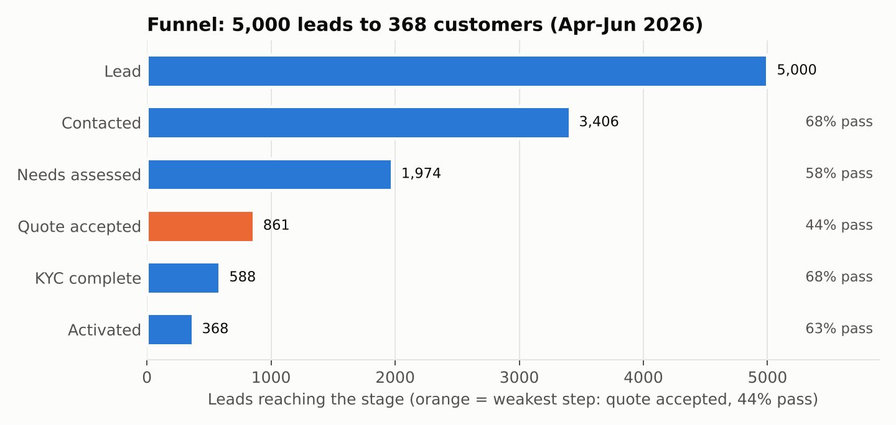
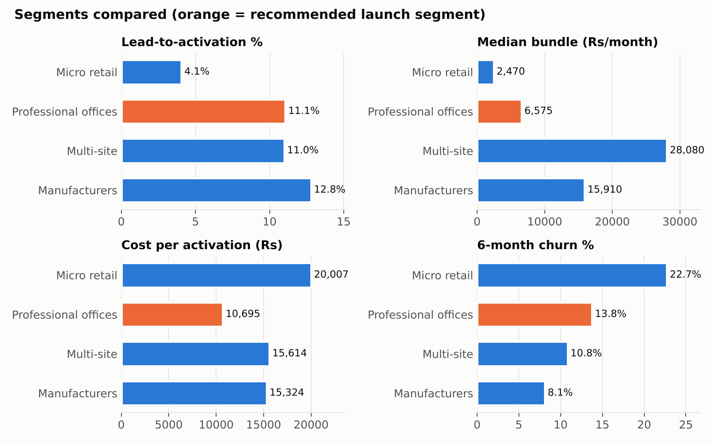
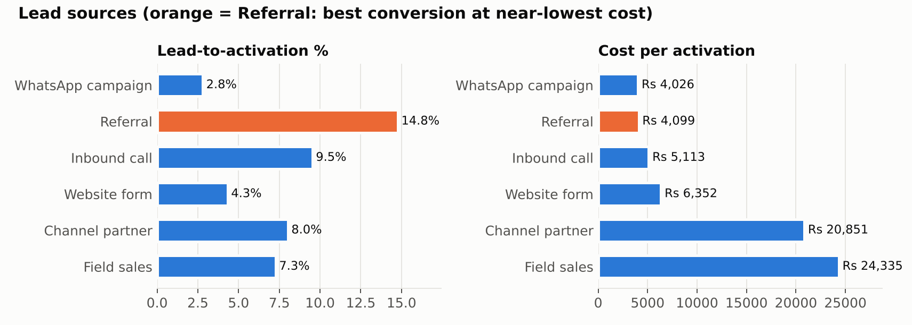
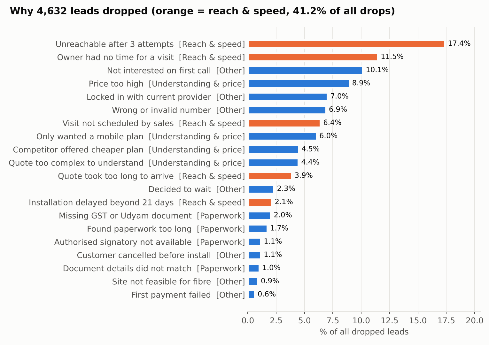
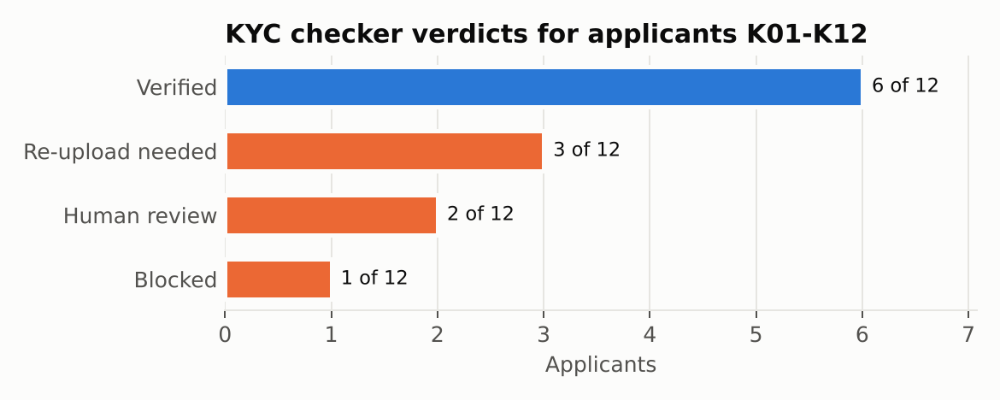
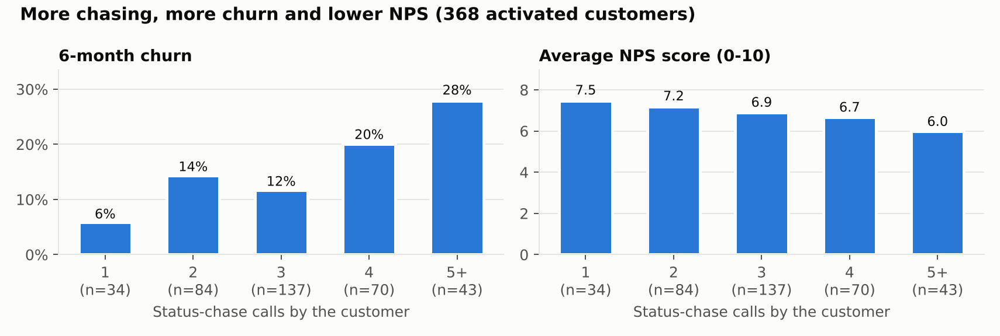
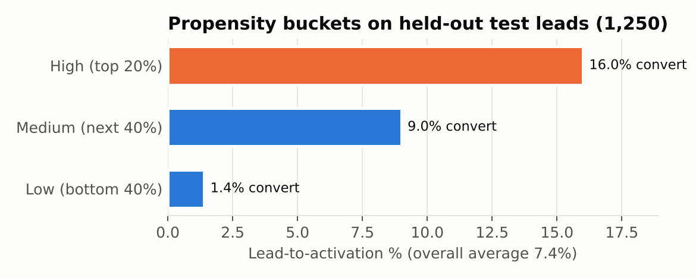
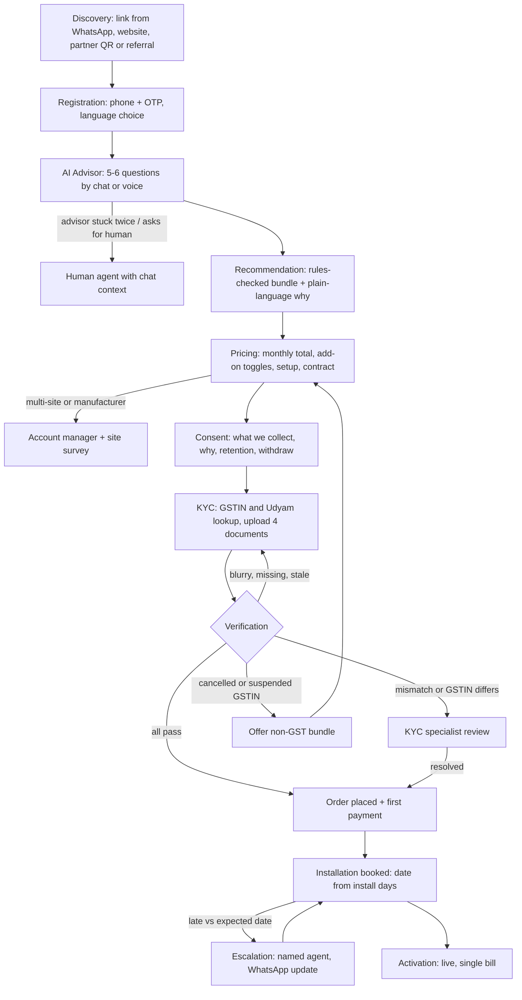

# How to read this document

This report turns the supplied data into a product decision. It moves in one direction: **raw data → analysis → findings → business implications → opportunities → recommended solution → build priorities.**

**Every number has a source tag.** The tag points to the file in the repository that produced it, so anyone can re-run and check it.

| Tag | Source file | What it contains |
|---|---|---|
| **[P]** | `analysis/01_profile.md` | Data quality, funnel check, registry joins |
| **[S]** | `analysis/02_signals.md` | Conversion, drop reasons, churn, bundles, lead sources (Q1–Q7) |
| **[B]** | `analysis/bundles_and_metrics.md` | Segment ranking, validated starter bundles, metric baselines and targets |
| **[M]** | `analysis/03_propensity.md` | Lead-scoring model results |
| **[F]** | `analysis/05_report_facts.md` | Segment profiles, source quality, personas, KYC-stage baselines |
| **[K]** | `analysis/kyc/kyc_results.md` | OCR and verification results for applicants K01–K12 |
| **[Case]** | `Airtel_SYNC_Case.pdf` and dataset README | Figures stated by the organisers |

**Four kinds of statement are kept apart:**

- **Evidence**: what the data shows, with a number and a tag.
- **Interpretation**: what we think the evidence means.
- **Assumption**: something we believe but cannot prove from this data.
- **Recommendation**: what we propose to build or do.

Where it matters, a statement is labelled with one of these words in bold.

**Plain-English glossary**

| Term | Meaning |
|---|---|
| Lead | A business that showed interest (filled a form, was visited, was referred) |
| Activation | The business is live and paying |
| Conversion | Share of leads that become activations |
| CAC | Customer acquisition cost: sales and partner money spent per activated customer |
| Churn | Customer leaves within 6 months |
| NPS | Satisfaction score, 0–10, given by activated customers |
| KYC | "Know your customer": GST certificate, Udyam certificate, signatory ID and address proof |
| GSTIN | 15-character GST registration number; it has a built-in check digit |
| Udyam | Government MSME registration number |
| Propensity score | A model's estimate of how likely a lead is to activate |
| AUC | How well a model ranks good leads above bad ones (0.5 = coin toss, 1.0 = perfect) |
| Lift | How much more often two products are bought together than chance would predict |


# Section 1 — Executive Summary

**What we are solving.** Accel Business (a fictional stand-in for Airtel Business) sells connectivity, communication, cloud, security and IoT products to small businesses: shops, clinics, CA firms, restaurant chains and small factories. Today it sells them one product at a time through a field sales force built for large companies. The case asks for a digital journey that lets an owner discover the right bundle, buy it and get it activated **on a phone, in their own language, with minimal human effort** [Case].

**Who the customers are.** Across 5,000 leads from one quarter, the split is:

| Segment | Share of leads | Typical example |
|---|---|---|
| Micro retail & services | 54.2% | kirana, salon, bakery |
| Professional offices | 24.9% | law office, coaching centre, diagnostic lab |
| Small multi-site businesses | 15.1% | hotel group, retail chain |
| Small manufacturers | 5.8% | moulding, packaging, textile units |

Source: [F]. This closely matches the case's indicative split of 55/25/15/5 [Case].

**What the journey looks like today.** A lead is contacted, a salesperson visits to assess needs, a quote is prepared, KYC documents are collected, and the service is installed. For customers who made it through, the steps took a median of 2, 3, 4, 4 and 4 days. Activation took **17.6 days** on average, and customers chased status **3.0 times** [S].

**Where it breaks.** Only **368 of 5,000 leads (7.4%)** became customers [P]. The weakest step is the quote: only **43.6%** of assessed leads accept it [F], and for micro businesses it's 32% [S]. The single largest group of losses is about reach and speed rather than price. Unreachable leads, owners with no time for a visit, visits never scheduled, slow quotes and late installs together cause **41.2%** of all drops [S].

**What the data says the opportunity is.**

- **Evidence.** About **32%** of today's drops have causes that a self-serve digital journey removes outright, and another **37%** have causes it partly addresses [S].
- **Evidence.** Sellers today sold **56 of 368** customers (15%) products the catalogue rules forbid, such as GST-only products on cancelled or missing GSTINs [S].
- **Evidence.** Customers who chased status five or more times churned at **28%**, against **6%** for those who chased once [S].
- **Evidence.** Referrals convert at **14.8%** for **Rs 4,099** per activation, while field sales converts at 7.3% for **Rs 24,335** [S].

**What the team should focus on.** We recommend a hybrid product (Section 13). An AI advisor and a rules engine handle discovery, pricing and KYC for the common case. A live tracker removes the need to chase. Exceptions go to a human with full context: KYC flags, delays, and multi-site deals. Launch with **professional offices** and treat multi-site businesses as an assisted track (Section 5).

**Five takeaways every teammate must understand**

1. **The quote step is the bottleneck.** Only 43.6% of assessed leads accept a quote, and just 32% for micro [F][S]. A clear, instant, plain-language price is the single most valuable screen we build.
2. **Speed beats price.** 41.2% of drops are about reach and speed, 23.9% about understanding and price, and 5.9% about paperwork [S]. Remove the wait and you remove the biggest leak.
3. **The advisor must enforce the catalogue rules.** Today, 15% of sold bundles break them [S]. The judges will test eligibility live, with 15 hidden scenarios [Case]. Rules decide eligibility; the AI only explains.
4. **The tracker is a retention feature.** Churn climbs from 6% to 28% as chase calls rise from 1 to 5+, and NPS falls from 7.5 to 6.0 [S].
5. **KYC is mostly lookups, but it needs a human safety net.** 6 of the 12 sample applicants have planted problems that the checker caught. Two of them can't be resolved by software alone: a GSTIN digit that differs from the registry, and a legal name that names a different business [K].


# Section 2 — Understanding the Business Problem

## 2.1 The current journey, stage by stage

| Stage | What happens | What the customer experiences | What the business needs | What can go wrong | What the data shows |
|---|---|---|---|---|---|
| **Lead → Contacted** | Sales or a partner tries to reach the lead | Waits for a call that may come at a bad time | Reach the owner while interest is fresh | Unreachable, wrong number, not interested | 1,594 leads lost (34.4% of all losses); 68.1% reached [F]. Unreachable after 3 attempts is the top drop reason overall (17.4%) [S] |
| **Contacted → Needs assessed** | A salesperson schedules a visit to understand needs | Has to find time for a meeting | Understand the business well enough to propose a bundle | Owner has no time; visit never scheduled; locked in with another provider | 1,432 lost (30.9%); 58.0% pass. "No time for visit" 531 and "visit not scheduled" 296 [S] |
| **Needs assessed → Quote accepted** | A quote is prepared and sent | Waits 3–5 days [Case] for a PDF with product codes | A price the owner understands and accepts | Too expensive, too complex, too slow, competitor cheaper | 1,113 lost (24.0%); **43.6% pass, the weakest step** [F] |
| **Quote → KYC complete** | GST, Udyam, signatory ID and address proof are collected | Hunts for documents and sends them physically or by email | Verified identity, compliant with the DPDP Act | Missing documents, paperwork fatigue, signatory unavailable, mismatched details | 273 lost; all 273 are paperwork reasons [F]. 68.3% pass |
| **KYC → Activated** | Installation and first payment | Waits for installation and chases status | Install fast, collect the first payment | Install late (over 21 days), cancellation, site not feasible for fibre, failed payment | 220 lost: 98 late installs, 53 cancellations, 41 not feasible, 28 payment failures [F] |

## 2.2 Symptoms and root causes

The data records **symptoms** (the drop reasons). We have to infer the **root causes**.

| Symptom (recorded) | Leads | Likely root cause (**interpretation**) |
|---|---:|---|
| Unreachable after 3 attempts; wrong number | 805 + 319 | The journey waits for the business to call the customer. Digital leads sit idle: 44% of WhatsApp-campaign drops and 34% of website-form drops are unreachable or wrong numbers [S] |
| Owner had no time for a visit; visit not scheduled | 531 + 296 | Discovery needs a physical meeting with a salesperson |
| Quote took too long; quote too complex | 179 + 206 | Quotes are made by hand and use product codes |
| Price too high; competitor cheaper; only wanted a mobile plan | 414 + 207 + 280 | Bundles are proposed without visible add-on choices, and some owners only wanted one product |
| Missing GST/Udyam; paperwork too long; signatory unavailable; details didn't match | 94 + 79 + 53 + 47 | Documents are collected manually with no lookup or pre-fill, and checks happen late |
| Installation delayed past 21 days; cancelled before install | 98 + 53 | Physical install capacity, and no visibility for the customer while waiting |

Counts are from [S].

## 2.3 Problems by type

| Problem type | Where it shows up in the data | Size |
|---|---|---|
| **Human dependency** | Visit needed to assess needs; quote prepared by a person | No time for visit 531, visit not scheduled 296 [S] |
| **Slow response** | Unreachable leads; slow quotes; 9.0 days pass before a quote is accepted | 805 unreachable; 179 slow quotes; 9.0 of the 17.6 days are pre-quote [S] |
| **Complex pricing** | Quote too complex; price too high | 206 + 414 [S] |
| **Documentation** | All KYC-stage drops | 273 [F] |
| **Lack of customer understanding** | Only wanted a mobile plan; 15% of bundles sold break the rules | 280 drops; 56 mis-sold customers [S] |
| **Poor follow-up** | 3.0 chase calls per customer; 68% chased 3 or more times | [F] |
| **Installation delays** | Installation delayed beyond 21 days | 98 drops; 16% of activations took over 21 days [F] |


# Section 3 — Dataset Understanding and Quality

## 3.1 The five data sources

| Dataset | Records | Purpose | Key columns | Connects to | Quality | Use in the product |
|---|---:|---|---|---|---|---|
| `product_catalogue.csv` | 25 | What can be sold, at what price, to whom | price min/max, setup fee, minimum contract, city tiers, min employees, min sites, requires GSTIN, requires one of, install days, target segments | `bundle_products` and `products_of_interest` in leads | No duplicates; no min > max prices; every dependency points to a real product [P] | Advisor rules engine, pricing, tracker dates |
| `smb_leads.csv` | 5,000 | One quarter of leads with outcome | segment, source, size, language, GSTIN/Udyam, current internet and spend, stage dates, drop reason, bundle, value, churn, NPS, acquisition cost | GSTIN registry (`gstin`), Udyam registry (`udyam_number`), catalogue | 40 consistency checks all returned 0; 124 blank `current_internet` (treated as Unknown) [P] | Analysis, propensity model, admin dashboard seed |
| `mock_gstin_registry.csv` | 3,534 | Backing data for a mock GSTIN lookup | gstin, legal name, trade name, constitution, address, state, registration date, status | Leads (every lead GSTIN is found) | 3,266 Active, 167 Cancelled, 101 Suspended [P] | `GET /kyc/gstin/{gstin}` mock API |
| `mock_udyam_registry.csv` | 2,723 | Backing data for a mock Udyam lookup | udyam number, enterprise name, type, activity, state, city | Leads (every lead Udyam number is found) | Names, cities and states all match the leads [P] | `GET /kyc/udyam/{number}` mock API |
| `kyc_documents/` | 47 images, 12 applicants | Specimen documents for OCR and validation | GST certificate, Udyam certificate, signatory ID, electricity bill | Registries, by GSTIN, Udyam number and name | One applicant (K05) has no Udyam certificate; several have planted problems [K] | Smart KYC test set |

## 3.2 Data profiling results

**Evidence [P]:**

- **No duplicate rows** in any file, and no duplicate keys (`lead_id`, `product_id`, `gstin`, `udyam_number`).
- **Nulls only where expected.** `gstin` is blank for 1,466 leads with no GSTIN. `udyam_number` is blank for 2,277 leads with no Udyam. Stage dates are blank after the stage a lead reached. Activation fields are blank for the 4,632 dropped leads. `current_internet` and `current_provider` are blank for 124 leads.
- **Format checks all pass.** All GSTINs are 15 characters. All Udyam numbers match `UDYAM-XX-00-NNNNNNN`. City tier is always 1 or 2. NPS is always 0–10. No negative amounts.
- **Stage logic is consistent.** No stage date comes before the previous one. Every activated lead has an activation date and a bundle. Every dropped lead has a drop reason. `days_lead_to_activation` equals activation date minus creation date in every row.
- **Ranges:** created between 2026-04-01 and 2026-06-30; 1–150 employees; 1–12 sites; telecom spend Rs 200–27,750 a month.

## 3.3 Registry matching

| Join | Result [P] |
|---|---|
| Leads with a GSTIN → GSTIN registry | 3,534 of 3,534 found. 3,266 Active, 167 Cancelled, 101 Suspended |
| Leads with a Udyam number → Udyam registry | 2,723 of 2,723 found. Name, city and state differ in 0 cases |
| Business name vs GST **legal** name | Differ in 2,443 cases, and every one is a proprietorship stored as "Owner (Prop. Trade name)" |
| Business name vs GST **trade** name | Differ in 0 cases |
| Lead state vs GST registry state | Differ in 0 cases. Each GSTIN state code maps to exactly one state |
| Activated leads with a Cancelled or Suspended GSTIN | 22 |
| Leads with Udyam but no GSTIN | 636 |

**Implication (recommendation):** KYC name matching must compare against the registry's **trade name**. Matching on legal name would wrongly flag about 2,443 honest proprietors. Name-only lookups are also unsafe, because names repeat across cities (Section 9).

## 3.4 How the datasets relate

```
product_catalogue ──(product_id)── smb_leads.products_of_interest / bundle_products
smb_leads ──(gstin)──────────────── mock_gstin_registry
smb_leads ──(udyam_number)───────── mock_udyam_registry
kyc_documents ──(GSTIN, Udyam no., names read by OCR)── both registries
```

The KYC images aren't keyed to lead IDs. They link to the registries only through the numbers and names printed on them. This is the same situation the real product will face.


# Section 4 — Complete Funnel Analysis

| Stage | Leads | Conversion from previous stage | Drop-off at this step | Share of all losses |
|---|---:|---:|---:|---:|
| Lead | 5,000 | — | — | — |
| Contacted | 3,406 | 68.1% | 1,594 | 34.4% |
| Needs assessed | 1,974 | 58.0% | 1,432 | 30.9% |
| Quote accepted | 861 | **43.6%** | 1,113 | 24.0% |
| KYC complete | 588 | 68.3% | 273 | 5.9% |
| Activated | 368 | 62.6% | 220 | 4.7% |

Source: [F]. All six counts match the README exactly [P].



*Interpretation:* bars shrink fastest early on. In absolute terms the first contact loses the most people, but the quote step has the lowest pass rate (orange). Two-thirds of all losses (65.3%) happen before anyone has seen a price.

**1. Where is the biggest loss?**

- **Evidence.** In absolute numbers, at first contact: 1,594 leads, or 34.4% of all losses.
- **Evidence.** In pass-rate terms, at the quote: only 43.6% of assessed leads accept it [F].

**2. Which stage has the most friction?**

- **Interpretation.** The quote. It's where an owner first meets the price and the product codes, after waiting days for it. In micro retail only 32% pass this step [S].

**3. What the numbers mean commercially.**

- **Evidence.** Rs 5.54 million was spent acquiring these leads (sum of `acquisition_cost_inr`), which works out to Rs 15,053 per activation [S].
- **Interpretation.** Every lead lost before the quote carries its acquisition cost without ever reaching a price.

**4. Which stages can automation improve?**

- **Recommendation.** Contact, needs assessment and quote can be collapsed into one self-serve session, the advisor. These steps account for 89.3% of all losses.
- **Recommendation.** KYC (5.9% of losses, all paperwork) can be largely automated with registry lookups and OCR.

**5. Which stages still need people?**

- **Interpretation.** Installation, and the exceptions around it: 98 late installs, 41 sites not feasible for fibre, 53 cancellations [F].
- **Interpretation.** KYC cases that software can't settle (Section 9).
- **Interpretation.** Multi-site deals with multi-week installs (Section 5).

**Comparison with the case baseline.** Our figures match the case: 7.4% conversion (the case says 7%), 17.6 days, 3 chase calls, CAC of about Rs 15,000, a Rs 6,900 median bundle, about Rs 2,500 for micro, and 9.6% vs 2.0% by GSTIN [Case][S].

One nuance is worth stating. The case calls quote acceptance the "steepest drop". That's true for the **pass rate** (43.6%). The largest **absolute** loss, though, is at first contact.

The case also describes installation and activation as taking 10–14 days. In the data, the step from KYC complete to activation takes a mean of 4.8 days. The 17.6 days is the whole journey from lead creation [S]. Both readings are consistent; they just measure different spans.


# Section 5 — Customer Segment Analysis

## 5.1 Comparison table

| | Micro retail & services | Professional offices | Small multi-site | Small manufacturers |
|---|---:|---:|---:|---:|
| Leads | 2,709 | 1,247 | 755 | 289 |
| Share of leads | 54.2% | 24.9% | 15.1% | 5.8% |
| Lead-to-activation | 4.1% | 11.1% | 11.0% | **12.8%** |
| Most common source | Field sales (33%) | Field sales (36%) | Field sales (37%) | Field sales (35%) |
| Median employees | 3 | 14 | 71 | 85 |
| Median sites | 1 | 1 | 8 | 1 |
| Median telecom spend now (Rs/mo) | 900 | 2,600 | 9,150 | 14,300 |
| Leads with GSTIN | 52.8% | 86.1% | 98.3% | 99.3% |
| Most-bought products (share of activated) | Business Postpaid 299 (100%), Biz Fibre 100 (92%), Cloud POS (34%) | Cloud Email (100%), Postpaid 599 (52%), Endpoint Security (49%) | Postpaid 599 (100%), Backup Failover (57%), Biz Fibre 100 (52%) | Postpaid 599 (100%), Cloud Email (100%), Leased Line 20 (51%) |
| Median bundle (Rs/mo) | 2,470 | 6,575 | **28,080** | 15,910 |
| 6-month churn | **22.7%** | 13.8% | 10.8% | 8.1% |
| Mean NPS (0–10) | 7.05 | 6.92 | 6.70 | 6.46 |
| Mean days to activate | 16.6 | 16.9 | 18.8 | 20.5 |
| Main drop reason | Unreachable (16%) | Unreachable (18%) | Unreachable (20%) | Unreachable (20%) |
| Cost per activation (Rs) | 20,007 | **10,695** | 15,614 | 15,324 |
| Typical businesses | Stationery shop, salon, boutique, mobile repair | Law office, coaching centre, travel agency, diagnostic lab | Budget hotel group, electronics chain, pharmacy chain, apparel chain | Plastic moulding, packaging, textile, auto-parts |

Source: [F], except mean days, churn and NPS, which come from [S] Q4.



*Interpretation:* no segment wins on every measure. Manufacturers convert best, multi-site businesses are worth the most per customer, and professional offices are the cheapest to win. Micro is the largest segment but loses on all four bars.

## 5.2 Answers

1. **Highest conversion:** small manufacturers (12.8%), though from only 289 leads [F].
2. **Greatest revenue opportunity:** multi-site businesses, at a median of Rs 28,080 a month per customer [F]. On first-year value per lead (conversion × median bundle × 12 × (1 − churn)), multi-site also comes first by a wide margin. Micro offers the greatest *volume* (54.2% of leads), but at Rs 2,470 a month.
3. **Lowest acquisition cost:** professional offices (Rs 10,695 per activation) [F].
4. **Highest churn:** micro retail (22.7%) [S]. Within micro, shops currently on a mobile hotspot churn at 29%, against 13% for micro shops that already have broadband [F].
5. **Easiest to onboard digitally:** professional offices (**interpretation**). They usually have one site, 86% have a GSTIN, their core bundle installs in 5 days, and they already live on email and cloud tools [F][B]. Micro is simple too, but only 52.8% have a GSTIN, which blocks the GST-only products [F]. Multi-site and manufacturer bundles involve SD-WAN, leased lines and installs of 14–30 days [B].
6. **Target first:** professional offices, with multi-site run in parallel as an assisted track (5.3).

## 5.3 The ranking formula and its limits

Phase 1.3 defined the score as **share of base × conversion × median bundle × 1 / churn** [B].

| Rank | Segment | Score index (top = 100) | Payback (months of bundle to cover CAC) |
|---|---|---:|---:|
| 1 | Small multi-site businesses | 100 | 0.6 |
| 2 | Professional offices | 31 | 1.6 |
| 3 | Small manufacturers | 29 | 1.0 |
| 4 | Micro retail & services | 6 | 8.1 |

**The formula ranks multi-site first. We still recommend launching with professional offices, because the formula leaves out three things:**

- **It ignores fit with self-serve.** The case asks for "minimal human effort" [Case]. Multi-site bundles need SD-WAN (minimum 3 sites, 14-day install) and installs at around 7 sites [B]. A human will usually have to close that deal.
- **It ignores what the digital journey changes.** Micro's score is low *today* because of its Rs 20,007 CAC and 32% quote acceptance [F][S]. Those are exactly the numbers a self-serve journey attacks, so micro is the phase-2 scale target rather than a segment to drop.
- **It treats a small sample as precise.** The manufacturer figures rest on 37 activated customers, so their churn (8.1%) and conversion (12.8%) carry wide uncertainty.


# Section 6 — Lead Source and Acquisition Analysis

| Source | Leads (share) | Conversion | Cost per lead (Rs) | Cost per activation (Rs) | Never contacted | Churn (activated) | NPS | Median bundle (Rs) | Share of all spend | Share of activations |
|---|---:|---:|---:|---:|---:|---:|---:|---:|---:|---:|
| WhatsApp campaign | 358 (7.2%) | 2.8% | 112 | 4,026 | 58.7% | 20.0% | 7.10 | 6,915 | 1% | 3% |
| Referral | 413 (8.3%) | **14.8%** | 605 | 4,099 | 21.1% | 24.6% | 7.11 | 5,730 | 5% | 17% |
| Inbound call | 504 (10.1%) | 9.5% | 487 | 5,113 | 19.8% | 14.6% | 6.65 | 6,960 | 4% | 13% |
| Website form | 995 (19.9%) | 4.3% | 274 | 6,352 | 45.1% | 11.6% | 7.07 | 8,110 | 5% | 12% |
| Channel partner | 1,010 (20.2%) | 8.0% | 1,672 | 20,851 | 28.8% | 18.5% | 6.75 | 5,110 | 30% | 22% |
| Field sales | 1,720 (34.4%) | 7.3% | 1,769 | **24,335** | 26.6% | 9.6% | 6.80 | 7,420 | 55% | 34% |

Source: [F]. Blended cost per activation is Rs 15,053 [S].



*Interpretation:* WhatsApp and referral cost about the same per activation, but referral converts five times better. Field sales and channel partners absorb 85% of spend and deliver 56% of activations.

**Highest volume:** field sales (34.4% of leads).

**Highest-quality customers:** it depends on the measure.

- Field sales customers churn least (9.6%) [F].
- Website-form customers have the highest median bundle (Rs 8,110) and low churn (11.6%) [F].
- Referral customers convert best but churn most (24.6%) [F]. Referrals are still the most efficient channel, but they need onboarding care after activation.

**Cheapest activations:** WhatsApp campaign (Rs 4,026) and referral (Rs 4,099) [F]. WhatsApp gets there by being cheap per lead, not by converting well: only 2.8% of its leads activate.

**Greatest digital opportunity:** website-form and WhatsApp leads.

- **Evidence.** 45.1% of website-form leads and 58.7% of WhatsApp leads are never contacted at all [F].
- **Evidence.** 34% and 44% of their drops respectively are "unreachable" or "wrong number" [S].
- **Interpretation.** These owners raised their hand online and then waited for a call. An advisor that answers immediately, in the same channel, is the most direct fix in the whole dataset.

**Recommended channel priorities:**

1. **Route website and WhatsApp leads straight into the advisor.** They're cheap, already digital, and today they're mostly wasted.
2. **Build referral into the product.** Give every activated customer a referral link, and give partners referral codes.
3. **Point field sales and partners at the high-value, assisted cases.** That means multi-site deals, manufacturers and KYC exceptions, with the app doing discovery and the quote first (Section 14.8).


# Section 7 — Customer Drop-Off and Root Cause Analysis

## 7.1 Drop reasons grouped



*Interpretation:* the two largest reasons, unreachable leads and owners with no time for a visit, are both about reach and speed (orange), and together they cause 28.9% of all drops. Paperwork is real, but it's small in volume.

| Group | Leads | % of all 4,632 drops | Most frequent reasons | Business impact | Software can fix? | Human needed? |
|---|---:|---:|---|---|---|---|
| **Reach & speed** | 1,909 | 41.2% | Unreachable (805), no time for visit (531), visit not scheduled (296), slow quote (179), install over 21 days (98) | The largest leak; acquisition money spent on leads nobody reaches | **Mostly.** Self-serve removes the visit and the quote wait; the tracker covers installs | For installs |
| **Understanding & price** | 1,107 | 23.9% | Price too high (414), only wanted a mobile plan (280), competitor cheaper (207), quote too complex (206) | Lost at the quote, the weakest step | **Partly.** Plain-language quote, right-sized bundles, add-on toggles, mobile-only option | No |
| **Paperwork** | 273 | 5.9% | Missing GST/Udyam (94), paperwork too long (79), signatory unavailable (53), details didn't match (47) | All of the KYC-stage losses | **Mostly.** Registry lookup, OCR pre-fill, mismatch caught at upload, e-sign | For flagged cases |
| **Other** | 1,343 | 29.0% | Not interested on first call (470), locked in with current provider (325), wrong number (319), decided to wait (107), cancelled before install (53), fibre not feasible (41), payment failed (28) | Mostly outside product control | **Rarely.** AirFiber fallback for no-fibre sites; payment retry | For retention offers |

Source: [S] Q3.

## 7.2 Root-cause matrix

| Root cause | Recorded symptoms | Software fix | Human role |
|---|---|---|---|
| Discovery needs a visit | No time for visit; visit not scheduled | Advisor chat or voice, available any time | None for the standard case |
| Leads wait for an outbound call | Unreachable; wrong number | The owner starts the session; WhatsApp follow-up | Call High-propensity leads first (Section 11) |
| Quotes made by hand, with product codes | Slow quote; quote too complex | Instant quote in plain language | None |
| Bundle not tailored | Price too high; only wanted mobile | Rules-checked bundle sized to the business, add-on toggles | None |
| Manual documents | Missing doc; paperwork too long; mismatch | Lookups, OCR, cross-checks at upload | Review flagged cases |
| No status visibility | 3.0 chase calls; churn rising with chasing | Live tracker and proactive updates | Named agent when a step runs late |
| Physical install capacity | Install over 21 days; not feasible | Expected dates; AirFiber fallback | Field installation teams |

## 7.3 How much a digital journey can realistically address

Each of the 20 drop reasons was classified as directly, partly or not addressable. The reasoning for each one is in [S] Q3.

| Class | Reasons | Leads | % of all drops |
|---|---|---:|---:|
| **Directly addressable** | No time for visit; visit not scheduled; slow quote; complex quote; missing GST/Udyam; paperwork too long; details didn't match; fibre not feasible; payment failed | 1,501 | **32.4%** |
| **Partially addressable** | Unreachable; install delayed; price too high; only wanted mobile; signatory unavailable; cancelled before install | 1,703 | **36.8%** |
| **Needs offline intervention or is out of reach** | Not interested; locked in; wrong number; competitor cheaper; decided to wait | 1,428 | **30.8%** |

Source: [S].

**Assumption.** The "partly" class won't be fully recovered. Read **32% as the floor** and **69% as the ceiling** of drops the journey can influence. Even recovering a fraction of the floor would lift conversion meaningfully (Section 16).


# Section 8 — Bundle and Product Intelligence

## 8.1 What the catalogue allows

Source for this subsection: [F].

- **25 products:** Connectivity 11, Communication 4, Cloud & Productivity 4, Security 3, IoT & Physical 3.
- **10 need an active GSTIN:** P03, P05, P06, P10, P12, P13, P14, P15, P21, P24.
- **7 need a base product in the same bundle:** P09, P10, P11, P12, P21, P22, P23.
- **One is sold in tier 1 cities only:** P03 Biz Fibre 1G.
- **Minimum employees:** P03 (5), P05 (10), P06 (25), P10 (10), P12 (3), P21 (10), P24 (10).
- **Minimum sites:** P10 Managed SD-WAN (3).
- **Setup, contracts and installs:** 12 products have a setup fee. Contracts run 1–24 months, and installs take 1–30 days.

**Traps worth knowing:**

- **Static IP (P11)** needs Biz Fibre (P01–P03). It can't go with a leased line, even though leased-line customers are the most likely to want one [S].
- **WhatsApp Business API (P15) and Business SMS (P14)** need a GSTIN. They are among the most-asked-about products (16.5% and 16.3% of leads), and 47.2% of micro leads have no GSTIN [F].

## 8.2 What customers actually buy

**Most purchased** (share of 368 activated customers) [F]:

- Business Postpaid 599 52%
- Biz Fibre 100 49%
- Business Postpaid 299 48%
- Cloud Email & Office Suite 48%
- Biz Fibre 300 27%
- Cloud CCTV 23%
- Endpoint Security 23%

**Bought together.** The most frequent pair is Biz Fibre 100 + Business Postpaid 299, in 116 baskets (31.5%). The strongest attachments by lift are [S]:

| Pair | Baskets | Lift |
|---|---:|---:|
| Cloud Telephony + Business SMS | 14 | 5.02 |
| Managed SD-WAN + Toll-free Number | 12 | 4.15 |
| Biz Fibre 1G + Static IP | 20 | 2.95 |
| Cloud Backup + Endpoint Security | 32 | 2.53 |

**Popular combinations by segment** [S]:

- **Micro** has a clear default: Biz Fibre 100 + Business Postpaid 299 (21 of 110 buys).
- **The other segments** buy almost-unique bundles: professional offices 138 customers, manufacturers 37, multi-site 83, with few repeats.
- **Interpretation.** A conversational advisor is a better fit than a fixed menu.

**Value, setup and contract** [F]:

- Median bundle Rs 6,900 a month.
- Setup fee: median Rs 2,650, mean Rs 13,879. The mean is pulled up by multi-site and manufacturer installs.
- Contracts: 304 of 368 customers are on 12 months, 61 on 24 months and 3 on 6 months.

**Bundle size and churn** [S]:

- 2-product bundles churn at 24.0%.
- 3–6 product bundles churn at 10.4–15.9%.
- 7+ product bundles churn at 20.6%.
- **Interpretation.** Very thin and very large bundles both carry more risk.

## 8.3 Recommended starter bundles (all validated)

Method [B]:

- **Core** = products at least 40% of the segment's activated customers bought.
- **Add-ons** = products 25–40% bought.
- **Quantities:**
  - per-site items = number of sites;
  - per-user items = the smaller of the segment median and the headcount;
  - everything else = the segment median.
- **Pricing:** micro at the catalogue minimum (very price-sensitive); other segments at the middle of the range.

`analysis/validate_bundles.py` ran **22 bundle checks and 9 must-refuse checks, with 0 failures** [B].

| Bundle | Profile tested | Core | Monthly | Setup | Contract | Install | With add-ons |
|---|---|---|---:|---:|---:|---:|---:|
| **Dukaan Digital** (micro) | 3 staff, 1 site; also 2 staff, tier 2, no GSTIN | Biz Fibre 100 + 2× Postpaid 299 | Rs 1,597 | Rs 0 | 12 mo | 5 days | Rs 2,794 (POS, Wi-Fi, CCTV) |
| **Office Pro** (professional) | 13 staff, 1 site, tier 2 | Biz Fibre 300 + 3× Postpaid 599 + 7× Cloud Email + 6× Endpoint + Backup | Rs 6,055 | Rs 0 | 12 mo | 5 days | Rs 10,055 (3× Cloud Telephony, Static IP) |
| **Chain Connect** (multi-site) | 7 sites, 61 staff, tier 2 | 7× Biz Fibre 100 + 7× Failover + 7× Cloud POS + 4× Postpaid 599 | Rs 19,575 | Rs 28,000 | 12 mo | 5 days | Rs 49,557, 24 mo (SD-WAN, CCTV, Wi-Fi, Toll-free, WhatsApp) |
| **Factory Line** (manufacturer) | 74 staff, 1 site, tier 2 | Leased Line 20 + 4× Postpaid 599 + 11× Cloud Email + 9× Endpoint | Rs 15,430 | Rs 10,000 | 12 mo | 21 days | Rs 21,164, 24 mo (Firewall, CCTV, 10× Machine IoT) |

**Why each bundle makes commercial sense** (**interpretation**, using numbers from [B][F]):

- **Dukaan Digital** is priced within reach of what micro customers pay today (median Rs 2,470 for activated bundles). It works without a GSTIN. The GST-only WhatsApp add-on appears only after the GSTIN lookup passes, and AirFiber (Rs 1,497, 2-day install) is the fallback where fibre isn't feasible.
- **Office Pro** at Rs 6,055 sits just under the segment's Rs 6,575 median. The 5-day install keeps activation short. A 4-person clinic gets Rs 5,393, because per-user items scale with headcount. The tier-1 upgrade to 1G fibre is correctly blocked for teams under 5 people.
- **Chain Connect** core comes in below the Rs 28,080 median. SD-WAN is the natural add-on because the segment asks for it most (14% of multi-site leads) and pairs it with Toll-free (lift 4.15) [S][F]. Its 14-day install is why this segment should be an assisted track.
- **Factory Line** matches the Rs 15,910 median. The leased line drives a 21-day install. Static IP is deliberately left out because it can't go with a leased line.

**Must-refuse cases the advisor has to handle** [B]:

- WhatsApp API without a GSTIN
- 1G fibre in a tier 2 city
- CCTV with no connection
- SD-WAN for 2 sites
- Leased line on a cancelled GSTIN
- Static IP on a leased line
- Cloud Telephony for 2 people
- Machine IoT for 6 people
- Toll-free on a suspended GSTIN


# Section 9 — KYC and Document Verification Findings

## 9.1 What was processed

All **47 images** for applicants K01–K12 were run through `scripts/kyc_check.py` [K]. The pipeline:

1. **Clean the image.** Strip the pink "SYNTHETIC SPECIMEN" watermark by colour, then threshold.
2. **Fix problem images.** Straighten tilted scans; measure sharpness and flag blurry images.
3. **Read the text** with Tesseract OCR.
4. **Repair the GSTIN.** Fix look-alike characters (0/O, 1/I, 2/Z, 5/S, 3/9, I/J, and so on) and keep only a candidate that passes the official GSTIN checksum *and* exists in the registry.
5. **Run every cross-check:**
   - registry status
   - legal and trade name
   - state code
   - Udyam number, name, city and state
   - bill date
   - bill name and address
   - signatory business, expiry and proprietor match
   - missing documents

**Every result below comes from actually running that pipeline.** The visual reading of each GSTIN was also checked against the checksum and the registry to confirm the pipeline's verdicts.

## 9.2 Registry and OCR facts

- **OCR quality:** median confidence across the 47 documents is 91.4%. The lowest is 43.8%, K04's blurred GST certificate [K].
- **GSTIN is the hardest field.** It's printed in a monospace font and the watermark crosses it. Raw OCR read only 1 of 11 readable GSTINs exactly right (K05). The checksum-plus-registry repair recovered 9 more automatically. The remaining one, K06, is a genuine problem and not an OCR error [K].
- **K02's GST certificate is tilted.** It was straightened by 7° automatically and then verified [K].
- **Name-only lookups are unsafe.** "Vindhya Tours & Travels" (K01) has Udyam records in Maharashtra, Delhi and Telangana (Hyderabad), but none in Visakhapatnam where K01 is. Matching on name alone would attach the wrong business [K].

## 9.3 Verdicts



*Interpretation:* half the sample is clean, so the happy path matters. The other half spreads across three outcomes that need different treatment: re-upload, human review, and hard block.

| Applicant | Business | Verdict | Planted issue found [K] |
|---|---|---|---|
| K01 | Vindhya Tours & Travels | **Blocked** | GSTIN 37IHKXV5167L1ZS is **Cancelled** in the registry; Udyam number field is **blank**; no Udyam record for this name in Visakhapatnam |
| K02 | Harmony Dental Care | Verified | None (tilted scan straightened automatically) |
| K03 | Ganesh Woodcraft | Verified | None |
| K04 | Saffron Dental Care LLP | **Re-upload** | GST certificate **too blurry to read** (sharpness 1.0, OCR 43.8%). The registry lookup by name shows the GSTIN is Active |
| K05 | Balaji Realty LLP | **Re-upload** | **Udyam certificate missing** (11 Udyam certificates for 12 applicants) |
| K06 | Saffron Unisex Salon | **Human review** | The GSTIN printed on the certificate **fails the checksum** and differs from the registry GSTIN for this business at character 8 ('8' printed, '5' in the registry). Not an OCR look-alike |
| K07 | Neelgiri Physio Clinic | **Human review** | Legal name reads "Neha Banerjee (Prop. **Shri** Physio Clinic)", but the trade name and registry say **Neelgiri** Physio Clinic |
| K08 | Green Leaf Legal Associates | Verified | None |
| K09 | Kaveri Insurance Advisors | Verified | None |
| K10 | Kaveri Stays LLP | Verified | None (signatory authority note, see 9.4) |
| K11 | Trinity Bake House Pvt Ltd | **Re-upload** | Address proof dated **2025-10-31**, which is 257 days before 2026-07-15 (limit 90) |
| K12 | Star Electronics | Verified | None |

**Limitation.** The judges hold the official KYC answer key [Case]. Our checker finds 6 flagged applicants. The key may list issues our checks don't look for, so compare against it as soon as it's available.

## 9.4 Handling each issue type

| Issue | What is wrong | How it's detected | What the customer is told | Auto-reject? | Human review? |
|---|---|---|---|---|---|
| Cancelled or suspended GSTIN (K01) | The business can't legally be sold GST-only products | Registry `status` ≠ Active | "Your GST registration shows as cancelled. You can still buy plans that don't need GST, or contact us if this is wrong." | **Yes** for GST-only products; offer non-GST bundle | Only if the customer disputes it |
| Blank Udyam number (K01) | The certificate is incomplete | Regex finds no number in the field | "We couldn't find a registration number on your Udyam certificate. Please type it or upload a clearer copy." | No | If still unresolved |
| Blurry image (K04) | Document can't be read | Sharpness score below threshold, low OCR confidence | "This photo is blurry. Please retake it in good light, holding the phone flat." | No: ask for a re-upload on the spot | No |
| Missing document (K05) | Required document not uploaded | Document checklist | "We still need your Udyam certificate. You can upload it or enter the number." | No | No |
| GSTIN on certificate ≠ registry (K06) | Possible typo, tampering or wrong certificate | Checksum fails, and the difference isn't an OCR look-alike | "The GST number on your certificate doesn't match government records. A specialist will check it with you." | **No:** never auto-reject a possible fraud flag | **Yes** |
| Legal name names a different business (K07) | Certificate inconsistent with registry | Word-level name match against trade name and registry legal name | "Your GST certificate shows a different business name. A specialist will confirm the details." | No | **Yes** |
| Stale address proof (K11) | Bill older than 90 days | Bill date vs 2026-07-15 | "Your bill is from Oct 2025. Please upload one from the last 3 months." | No: ask for a re-upload | No |
| Tilted scan (K02) | OCR accuracy drops | Page-angle detection | Nothing; it's fixed silently | No | No |
| Company/LLP signatory (K04, K05, K10, K11) | Registry has no director list, so signing authority can't be proven | Constitution ≠ Proprietorship | "Please confirm you're authorised to sign for the company (e-sign or authorisation letter)." | No | Spot-check |

**Recommendation.** Use three outcomes:

- **Fix it now:** re-upload or type the number.
- **Specialist review:** mismatches and possible fraud.
- **Hard block:** a cancelled GSTIN for GST-only products.

Only a cancelled or suspended GSTIN should block anything automatically. Everything else gives the owner a clear next step.


# Section 10 — Customer Experience Insights

## 10.1 What the lead data says about customers

Source for this subsection: [F], unless marked [S].

**Languages.**

| Language | Share of leads | Conversion |
|---|---:|---:|
| Hindi | 42.7% | 7.9% |
| English | 23.4% | 8.0% |
| Marathi | 10.1% | 6.3% |
| Kannada | 5.1% | 5.1% |
| Gujarati | 4.7% | 6.0% |
| Telugu | 4.1% | 7.7% |
| Tamil | 4.1% | 4.3% |
| Bengali | 2.2% | 9.0% |
| Punjabi | 1.9% | 4.2% |
| Malayalam | 1.7% | 8.4% |

- Hindi and English cover 66.1% of leads, and regional languages the other 33.9%.
- In each state, the local language is the top choice for 42–52% of leads (e.g. Tamil 45% in Tamil Nadu, Marathi 49% in Maharashtra).
- Regional-language leads accept the quote 40% of the time, against 45% for Hindi and English [S].

**Business types.** Ten micro types each have 258–291 leads and convert at 3.0–5.7%. Among professional offices, law offices convert at 14.1% and coaching centres at 8.9%.

**Size.** Median 6 employees; the middle half has 3–21. A quarter of leads have 3 or fewer.

**Current internet.**

| Current setup | Leads | Median spend (Rs/mo) | Conversion |
|---|---:|---:|---:|
| Mobile hotspot | 1,799 | 950 | 4.5% |
| Business broadband | 1,433 | 3,250 | 9.3% |
| Home broadband | 1,250 | 1,300 | 7.6% |
| Mixed per site | 221 | 9,300 | 12.7% |
| Leased line | 173 | 11,750 | 15.0% |

**Current provider.**

- **1,890 leads (37.8%) already use Accel**: 1,505 for mobile only and 385 for more. They convert at 9.2%, against 6.2% for everyone else.
- Competitor A converts at 6.5%, Competitor B at 7.4% and local ISPs at 5.4%.

**Telecom spend.**

- Median by segment: micro Rs 900, professional Rs 2,600, multi-site Rs 9,150, manufacturer Rs 14,300 a month.
- Activated customers' bundles cost a median **2.59×** what they spent before. By segment: micro 2.74×, professional 2.66×, manufacturers 1.23×, multi-site 3.04×.

**Products of interest.**

- The most-asked-about products are Postpaid 299 (16.8% of leads), WhatsApp API (16.5%), Secure Wi-Fi (16.3%), Business SMS (16.3%), Cloud CCTV (15.7%) and Website (15.0%).
- Leads asking about those convert at only 4.5–6.4%.
- Leads asking about Cloud Backup (14.1%), 1G fibre (12.5%), Failover (12.5%), Firewall (12.4%) or Endpoint Security (12.2%) convert at roughly double that rate.

**Follow-up behaviour.** 68% of activated customers chased status 3 or more times. Chasing rises churn from 6% to 28% and lowers NPS from 7.5 to 6.0 [S].



*Interpretation:* both panels move in the same direction as chasing increases. Chase calls barely track how long activation took (correlation +0.01) [S], so it's the not-knowing that hurts, not just the wait. A status page the owner can check is the remedy.

**Activation duration.** Mean 17.6 days, range 7–31. 23% activated within 14 days and 16% took over 21 days.

**NPS.** Among activated customers, 18% are promoters, 38% passives and 43% detractors, for an NPS-style score of −25. The mean score is 6.86.

## 10.2 Personas, built from the actual slices

All figures are from [F].

**1. Ravi, mobile-hotspot shopkeeper** (micro on hotspot: 1,597 leads, 31.9%)

- **Profile:** median 4 staff, 1 site, spends Rs 900/month. 53% have a GSTIN. Hindi 44%, English 24%, Marathi 10%. Mobile repair shops, stationery shops, bakeries, pharmacies. 41% of contacts are the owner.
- **Main pain:** unreachable (18%), no time for a visit (12%), price too high (11%). Converts at 4.1%, churns at 29% after activation.
- **What he asks for:** WhatsApp API (23%), website (23%), guest Wi-Fi (22%), a business SIM (22%).
- **Best channel:** voice or WhatsApp, in Hindi or a regional language, outside shop rush hours.
- **Likely objections:** "Too expensive." "I don't have GST." "I can't leave the shop."
- **Recommended experience:** a 3–4 question voice chat and a Rs 1,597 core bundle. WhatsApp API is shown only after a GSTIN passes. AirFiber is offered if there's no fibre. A clear monthly total with nothing hidden.

**2. Meena, shop owner who already has broadband** (micro with broadband: 1,112 leads, 22.2%)

- **Profile:** median 3 staff, Rs 900/month. Salons, boutiques, sweet shops.
- **Main pain:** unreachable (14%), no time for a visit (13%).
- **What she asks for:** Cloud CCTV (28%), AirFiber (23%), Wi-Fi (22%), POS (22%).
- **Outcome after activation:** churn 13%, much lower than Ravi's 29%.
- **Recommended experience:** lead with the add-on she asked about, CCTV or POS, on top of a fibre-plus-SIM core.

**3. Dr Arjun, professional office** (1,247 leads, 24.9%)

- **Profile:** median 14 staff, 1 site, Rs 2,600/month. 86% have a GSTIN. Law offices, coaching centres, travel agencies, diagnostic labs. 40% of contacts are the owner, 20% a partner.
- **Main pain:** unreachable (18%), not interested on first call (10%), no time (10%).
- **Asks about:** Biz Fibre 300 (13%), Endpoint Security (12%), Toll-free (12%).
- **Outcome after activation:** median bundle Rs 6,575, churn 14%, 16.9 days to activate.
- **Best channel:** chat on a phone or laptop, English or Hindi, any time.
- **Likely objections:** data security, downtime, "will email migration be painful?"
- **Recommended experience:** Office Pro with seats auto-sized to headcount, uptime and security explained in plain words, a 5-day install date shown upfront.

**4. Priya, multi-site chain operator** (755 leads, 15.1%)

- **Profile:** median 71 staff, 8 sites, Rs 9,150/month. 98% have a GSTIN. Hotel groups, electronics, pharmacy and apparel chains.
- **Asks about:** SD-WAN (14%), WhatsApp API (13%), SMS (12%).
- **Main pain:** unreachable (20%).
- **Outcome after activation:** median bundle Rs 28,080, churn 11%, 18.8 days to activate.
- **Recommended experience:** the app builds a per-site quote and books a survey. A named account manager closes the deal.

**5. Suresh, small manufacturer** (289 leads, 5.8%)

- **Profile:** median 85 staff, 1 site, Rs 14,300/month. 99% have a GSTIN. Moulding, packaging, textile and auto-parts units.
- **Asks about:** Cloud Backup (20%), Postpaid 599 (18%), Endpoint Security (17%), Static IP (17%).
- **Outcome after activation:** median bundle Rs 15,910, churn 8%, 20.5 days to activate.
- **Recommended experience:** the advisor explains why Static IP needs fibre, offers the leased-line or 1G route, and hands over to a specialist for the site survey.

## 10.3 What this means for the UI and the advisor

- **Languages.** At launch, support Hindi and English plus the five largest regional languages: Marathi, Kannada, Gujarati, Telugu and Tamil. Together that's 94.2% of leads [F]. Offer voice for owners who'd rather speak than type.
- **Questions.** Ask at most 5–6 short questions. Ask about the GSTIN early, because it decides what can be sold, and a lead with a GSTIN is 4.7× more likely to activate [S].
- **Pricing language.** Show the monthly total, then a "compared with what you pay now" line. Bundles cost a median 2.6× previous spend [F], so explain what's new (CCTV, POS, backup) rather than hiding the total.
- **Ineligible requests.** When an owner asks for something they can't have yet (e.g. WhatsApp API without a GSTIN), say why and what unlocks it. Don't silently drop it.
- **Status updates.** Make status the home screen after purchase, with proactive WhatsApp updates, so the owner never needs to chase.


# Section 11 — Propensity Model Findings

| Item | Detail [M] |
|---|---|
| **Target** | `outcome == "Activated"` (7.4% of leads) |
| **Features** | Segment, lead source, preferred language, current internet, turnover band, has GSTIN, has Udyam, city tier, employees (log), sites, telecom spend (log), number of products asked about. All known when the lead is created |
| **Left out on purpose** | Stage dates, drop reason, chase calls, bundle and value fields: these are only known later, so including them would be cheating ("leakage"). Also GSTIN *status*: past sellers closed deals on cancelled GSTINs, so the model would have learned to reward a compliance problem |
| **Preparation** | One-hot encoding for categories, scaling for numbers, class balancing because only 7.4% are positive |
| **Method** | Stratified 75/25 split (3,750 train / 1,250 test) plus 5-fold cross-validation |
| **Models** | Logistic regression: test AUC **0.731**, cross-validated AUC 0.706. LightGBM: test AUC 0.688 |
| **Chosen** | Logistic regression. It's at least as accurate, and every reason can be explained |
| **Precision in top 20%** | The top-scored 20% convert at **16.0%**, against 7.4% overall, and hold **43%** of all activations |



*Interpretation:* the three buckets separate cleanly on leads the model never saw. Low-bucket leads almost never convert (1.4%).

**Buckets.**

- On the test set: High 16.0%, Medium 9.0%, Low 1.4%.
- After refitting on all 5,000 leads: High 15.9%, Medium 8.7%, Low 1.8% [M].

**Top factors.**

- **Raise the odds:** came via referral, has a GSTIN, came via inbound call, manufacturer or multi-site segment, prefers Hindi or English, on a leased line or mixed setup, turnover Rs 5–25 crore.
- **Lower the odds:** WhatsApp-campaign source, micro segment, no GSTIN, website-form source, prefers Tamil or Kannada, tier 2 city, turnover under Rs 40 lakh.

**How admins use it.**

- The dashboard sorts unclosed leads by bucket and shows the top 3 reasons ("+ came via Referral, + has a GSTIN, − tier 2 city").
- Calling only the High bucket reaches 43% of future customers with a fifth of the calls [M].
- Low-bucket leads stay in the self-serve journey and get WhatsApp nudges, not calls.

**Correlation is not causation.**

- **Interpretation.** "Prefers Tamil" lowers the score. That doesn't mean Tamil speakers want the products less; it more likely reflects how badly today's process serves them.
- **Interpretation.** WhatsApp-campaign leads score low because nobody called them back (58.7% were never contacted [F]), not because WhatsApp brings poor customers.
- **Recommendation.** The model tells us *whom to call first today*. It must not decide whom to serve, and we should expect its weights to change once the journey changes.

**Limitations.**

- An AUC of 0.73 is useful but modest.
- Scores rank leads; they aren't calibrated probabilities. Show the bucket's conversion rate, not the raw score.
- It's trained on a synthetic quarter under the old process.
- Retrain it once app data exists.


# Section 12 — Business Opportunities

| Identified problem | Evidence | Proposed opportunity | Expected benefit | Priority |
|---|---|---|---|---|
| Discovery needs a visit; leads go unreached | No time for visit 531, visit not scheduled 296, unreachable 805 [S] | **AI business advisor** (chat, then voice) that the owner starts any time | Removes the visit; serves digital leads instantly | Must |
| Quote is the weakest step | 43.6% acceptance; complex 206, slow 179 [F][S] | **Guided package recommendation with instant, plain-language pricing** and add-on toggles | Higher quote acceptance; no 3–5 day wait | Must |
| Mis-selling | 15% of activated bundles break rules [S]; 15 live advisor tests [Case] | **Deterministic rules engine** behind the AI | Zero ineligible bundles; passes judge scenarios | Must |
| Paperwork drops and late mismatches | 273 KYC-stage drops; 47 mismatches [F] | **Digital KYC:** consent, GSTIN/Udyam lookup, pre-fill | Fewer missing documents; faster KYC | Must |
| Bad documents found too late | 6 of 12 applicants flagged [K] | **OCR discrepancy detection** at upload, with specific fix-it messages | Problems fixed in the same session | Must |
| Customers chase status | 3.0 calls; churn 6% → 28% [S] | **Order tracker** with expected dates from catalogue install days | Fewer calls; lower churn | Must |
| Cases software can't settle | K06, K07; late installs 98 [K][F] | **Human escalation** with full context and a named agent | Exceptions resolved without the owner repeating themselves | Must |
| Limited sales capacity spread evenly | Top 20% of leads hold 43% of activations [M] | **Lead prioritisation** (propensity) on the admin dashboard | More activations per call | Should |
| Regional speakers convert worse | Regional quote acceptance 40% vs 45% [S]; Tamil 4.3%, Punjabi 4.2% [F] | **Multilingual voice interaction** | Narrows the language gap | Should |
| Digital leads abandon and go silent | WhatsApp 44% / website 34% of drops unreachable [S] | **WhatsApp reminders** (opt-in) for incomplete KYC and status | Recovers stalled journeys | Should |
| No visibility of whether it works | Baselines exist; no live tracking | **Admin analytics** on the 5 metrics | Shows impact; steers the pilot | Should |
| Price objections | Price too high 414; competitor cheaper 207 [S] | Price **transparency and right-sizing** (headcount-based seats, catalogue-minimum pricing for micro) | Fewer price drops | Should |
| Price objections (aggressive option) | Same | **Dynamic pricing / discounts** | Unclear; risks margin and trust | Won't (now) |
| Existing Accel customers convert better | 37.8% of leads already use Accel; 9.2% vs 6.2% conversion [F] | Pre-filled upgrade journey for existing mobile customers | Cheaper, warmer acquisition | Could |
| Referral is the best channel | 14.8% conversion, Rs 4,099 per activation [S] | Referral link after activation; partner codes | More of the best-value leads | Could |

**Not recommended now:** dynamic pricing. Nothing in the data shows that discounts move conversion, and changing prices per customer would undercut the "one transparent price" the case asks for [Case].


# Section 13 — Alternative Product Solutions

## A. AI-first self-service onboarding platform

- **Target customer:** every segment, fully self-serve.
- **Main functionality:** advisor, quote, KYC, payment and tracker, with no humans in the loop. Exceptions get an error message or a "call us" number.
- **Journey:** chat → bundle → pay → upload → wait.
- **Technical complexity:** medium.
- **Business value:** high CAC savings on simple cases.
- **Implementation effort:** medium.
- **Risks:**
  - Exceptions dead-end. 6 of 12 KYC applicants needed a fix or a review [K].
  - The 220 post-KYC losses are all physical or payment issues [F].
  - Multi-site deals can't close without a survey.
  - It contradicts the case's question 4 on the role of the field force and partners [Case].
- **Advantages:** simplest story; cheapest per activation.
- **Disadvantages:** abandons the hardest and most valuable customers. A dead-end at KYC recreates today's paperwork drop.

## B. Hybrid AI + human-assisted onboarding platform

- **Target customer:** professional offices and micro self-serve; multi-site and manufacturers assisted.
- **Main functionality:** everything in A, plus automatic escalation (late step, KYC flag, advisor stuck, "talk to a person") to a named agent who sees the full context, plus an admin view with propensity-ranked unclosed leads.
- **Journey:** chat → bundle → consent → KYC → tracker. A human steps in only on exceptions.
- **Technical complexity:** medium-high. It adds an escalation queue, agent assignment and an admin dashboard.
- **Business value:** keeps A's savings on the common case and recovers the exceptions.
- **Implementation effort:** high, but it can be built in layers.
- **Risks:** scope creep; agent capacity during a pilot.
- **Advantages:**
  - Matches the principle "AI handles acquisition; humans handle exceptions."
  - Answers every key question in the case.
  - Uses the field force where the data says they add value.
- **Disadvantages:** more to build and demo; needs clear escalation rules.

## C. Assisted digital sales platform for agents and channel partners

- **Target customer:** sales staff and partners, who use the app on behalf of owners.
- **Main functionality:** a quote builder, KYC capture and lead scoring for agents.
- **Journey:** agent visits → app builds the quote → agent collects documents.
- **Technical complexity:** medium.
- **Business value:** faster quotes and fewer mis-sells.
- **Implementation effort:** medium.
- **Risks:** keeps the visit, which today causes 827 drops (no time 531, not scheduled 296) [S]. Keeps the Rs 20,851–24,335 per-activation cost of partner and field channels [F].
- **Advantages:** easy adoption by the existing sales force.
- **Disadvantages:** doesn't meet the case's core ask: "on a phone, in their preferred language, with minimal human effort" [Case].

## Weighted decision matrix

The weights and scores below are the **team's judgement**, informed by the evidence cited above. They are not computed from the data. Scores run from 1 to 5, and the weighted total is out of 5.

| Criterion | Weight | A: AI-first | B: Hybrid | C: Agent tool |
|---|---:|---:|---:|---:|
| Fit to case requirements (self-serve, phone, language, field-force role) | 25% | 4 | 5 | 2 |
| Addresses the observed drop causes (reach/speed 41%, quote 44% pass, KYC 273, install 220) | 25% | 3 | 5 | 3 |
| Feasible within the hackathon | 20% | 4 | 3 | 4 |
| Business value (CAC, conversion, churn) | 15% | 4 | 5 | 3 |
| Risk (dead-ends, compliance, adoption) | 15% | 2 | 4 | 3 |
| **Weighted total** | 100% | **3.45** | **4.45** | **2.95** |

**Recommendation: B, the hybrid.**

- **It's the only option that covers both ends of the funnel.** That means the 65% of losses before the quote and the exceptions after it (KYC flags, installs) [F][K].
- **A loses** on risk and drop coverage. With no human, the exception path dead-ends, and that path held half the KYC sample.
- **C loses** on fit. It keeps the visit and the most expensive channels, which are the very things the data identifies as the problem.


# Section 14 — Recommended Product Strategy

1. **Positioning.** "Your business connected in one sitting." A phone-first advisor that recommends, prices and verifies in the owner's language, with a real person when needed.
2. **Primary segment.** Professional offices: clinics, law and CA offices, coaching centres, diagnostic labs. They convert at 11.1%, have the lowest CAC (Rs 10,695), have 86% GSTIN coverage, and a 5-day core install [F][B].
3. **Secondary segments.**
   - **Micro retail (phase 2, scale).** The largest segment (54.2%), and the one whose specific failures the journey fixes: quote acceptance of 32% and CAC of Rs 20,007 [S][F].
   - **Multi-site (assisted track from day 1).** The highest value (Rs 28,080 median), closed by an account manager with the app's quote [F].
   - **Manufacturers (assisted).** Leased-line installs take 21 days [B].
4. **Core customer problem.** Buying business connectivity today takes a visit, a slow and confusing quote, paper KYC and 17.6 days of waiting, with 3 chase calls [S].
5. **Value proposition.**
   - The right bundle in minutes, priced in plain words.
   - Documents checked while you upload them.
   - A live date you can check instead of calling.
6. **Essential features:**
   - advisor with rules engine
   - instant quote with add-on toggles
   - consent and Smart KYC (lookups, OCR, cross-checks)
   - order tracker
   - escalation to a named human
7. **Differentiating features:**
   - multilingual voice
   - WhatsApp updates
   - propensity-ranked admin dashboard
   - live metrics against baseline
8. **Human intervention strategy.** A human is brought in only when one of these happens:
   - a KYC check needs judgement (K06/K07-type cases);
   - a step is late against its expected date;
   - the advisor fails twice or the owner asks;
   - the deal is multi-site or a manufacturer.

   Field staff and partners take over these cases, plus High-propensity leads that didn't finish. They get credit (referral codes, commission on app-completed sales), so the digital journey feeds them rather than competing with them.
9. **Revenue and pricing logic.** Catalogue prices only, no discounts. Micro is priced at the catalogue minimum because it's very price-sensitive [Case]; other segments sit at the middle of the range. The quote shows one monthly total, the setup fee separately, and the contract length (the longest minimum contract in the bundle) [B].
10. **Success metrics.** Section 16.

**How this differs from a conventional telecom CRM.**

- **Who drives it.** A CRM records what salespeople do. This product *does the selling* for the standard case and hands people only the exceptions.
- **How eligibility works.** It enforces eligibility by rule, where 15% of bundles break the rules today [S].
- **Who sees status.** The customer sees the status, instead of the status living in an internal system.


# Section 15 — Proposed Customer Journey




| Step | Customer action | System action | Data needed | Output | Possible failure | Recovery | Human? |
|---|---|---|---|---|---|---|---|
| Discovery | Taps a link or scans a QR code | Opens the app in the referred context | Source, referral code | Session started | Link never opened | WhatsApp reminder (opt-in) | No |
| Registration | Enters phone, gets OTP, picks a language | Creates an account; records WhatsApp opt-in | Phone, language | Logged-in user | OTP not received | Resend; voice OTP | No |
| AI advisor | Answers 5–6 questions by text or voice | Builds the profile; asks for the GSTIN early | Business type, staff, sites, city, current setup, needs, GSTIN (optional) | Profile | Unclear answers; owner gives up | Rephrase; offer options; save and resume | If stuck twice |
| Recommendation | Reads the bundle and the reasons | Rules engine filters eligible products; AI explains | Profile, catalogue | Valid bundle | No eligible product (e.g. tier 2 + 1G request) | Explain why and offer the nearest valid option | No |
| Pricing | Toggles add-ons; sees the total | Recomputes the price; blocks invalid removals | Bundle, price rule | One monthly price | "Too expensive" | Show a smaller valid bundle; compare with current spend | For multi-site |
| Consent | Reads the notice and agrees | Stores consent (time, version, purpose) | — | Consent record | Declines | Explain what's needed; allow save and exit | No |
| KYC | Enters the GSTIN; uploads 4 documents | Registry lookup pre-fills details; OCR reads documents | GSTIN, Udyam, 4 images | Extracted fields | Blurry or missing document | Instant re-upload prompt with a specific reason | No |
| Verification | Waits seconds | Runs every cross-check | Extracted fields, registries | Pass / fix / review / block | Mismatch; cancelled GSTIN | Specialist review; non-GST bundle | For mismatches |
| Order | Pays the first bill | Creates the order and schedules the install | Payment | Order ID | Payment fails | Retry; UPI alternative | No |
| Installation | Checks the tracker | Shows the expected date; sends proactive updates | Install days per product | Booked date | Late; site not feasible for fibre | Auto-escalate; AirFiber fallback | If late |
| Activation | Starts using the service | Marks it live; single bill; invites a referral | — | Active customer | Early dissatisfaction | Check-in message; referral offer after the first bill | No |


# Section 16 — Business Impact and Success Metrics

**All targets below are proposals for a 6-month pilot. None has been achieved yet.**

| Metric | Definition | Baseline | Proposed target | How measured | Why it matters |
|---|---|---|---|---|---|
| Lead-to-activation | Activated ÷ leads created, by cohort | **7.4%** [P] | 11% | Order and lead tables, weekly by segment and channel | The headline outcome |
| Average activation time | Lead created → live, in days | **17.6 days** [S] | 8 days | Timestamps on order events | NPS falls as days rise (correlation −0.28) [S] |
| Customer acquisition cost | Sales and partner spend ÷ activations | **Rs 15,053** [S] | Rs 8,000 | Spend ledger ÷ activations | Today's CAC is 2.2× the median monthly bill |
| Six-month churn | Share of activations lost within 6 months | **15.2%** [B] | 11% | Billing status at 6 months | Lifetime value |
| Follow-up calls per customer | Customer-initiated status contacts | **3.0** [S] | under 0.5 | Support contacts tagged "status" | Churn rises from 6% to 28% with chasing [S] |
| KYC completion rate | KYC complete ÷ quote accepted | **68.3%** (588/861) [F] | 85% | Funnel events | All 273 KYC-stage losses are paperwork [F] |
| Document mismatch rate | Share of KYC submissions lost to mismatched details | **5.5%** of quote-accepted leads dropped for "details did not match" (47/861) [F] | under 2% lost; 100% of mismatches flagged at upload | KYC check results | Mismatches should be fixed in-session, not discovered later |
| Escalation resolution time | Escalation opened → resolved | **No baseline in the data.** The nearest proxy is 3.0 chase calls [F] | First response within 4 business hours; resolved within 24 hours | Escalation table timestamps | Exceptions are where human time is spent |

**How the main targets were derived** [B]:

- **Conversion: 11%.** Professional offices already convert at 11.1% and referrals at 14.8%.
- **Days: 8.** About 9.0 of the 17.6 days pass before a quote is accepted, and 3.8 more for KYC. The core installs for micro and professional bundles take 5 days.
- **CAC: Rs 8,000.** Digital leads cost Rs 232 each; at 11% conversion that's about Rs 2,106 per self-serve activation. Field and partner deals cost Rs 22,965 today. A 50/50 mix, with assisted deals 40% cheaper because the app does discovery and KYC, gives about Rs 7,942.
- **Churn: 11%.** Customers who chased once churned at 6% and twice at 14%.

**Assumptions to validate:** the 50/50 mix, the 40% saving on assisted deals, and the KYC completion target are assumptions. The pilot should measure them.


# Section 17 — Technical Implications

This section turns findings into requirements. It deliberately avoids locking in technology choices.

| Area | What the findings require |
|---|---|
| **Frontend** | Mobile-first, works on low-end phones and slow networks. All text in language files (7 languages cover 94.2% of leads [F]). Large tap targets. Status as the post-purchase home screen |
| **Backend services** | Separate services or modules for: advisor, rules and pricing, KYC, orders and tracker, escalation, notifications, admin. Each step writes an event, so the funnel metrics are computable |
| **AI advisor** | Language model for the conversation only: asking, summarising, explaining. It never decides eligibility or price. It asks for the GSTIN early. It stays inside the catalogue |
| **Rules engine** | Deterministic code enforcing tier, minimum employees, minimum sites, active GSTIN and dependencies, returning a reason for every rejection. Already prototyped as `validate_bundles.py`, with 31 passing checks [B]. Must pass the judges' 15 live scenarios [Case] |
| **Product recommendation** | Start from the segment's validated starter bundle, then add the products the owner asked for if eligible. Per-site and per-user quantities scale with the profile |
| **Pricing** | One documented rule (micro at the minimum, others at the midpoint), setup fee separate, contract = longest minimum contract. Recompute on every toggle |
| **OCR** | Watermark and colour cleanup, deskew, blur detection, GSTIN checksum repair against the registry, word-level name matching. Already prototyped: 6 of 12 flagged, 6 verified [K]. Low-confidence reads go to "confirm" or review, never silent acceptance |
| **Registry APIs** | Mock GSTIN and Udyam lookups backed by the CSVs. Never match on name alone; use the number, or name plus city/state |
| **Database** | Leads, users, conversations, quotes, orders, order events, KYC cases and checks, consents, escalations, agents, notifications. Personal identifiers masked in UI and logs; documents kept for a stated period |
| **Propensity model** | Logistic regression served from a saved model, returning score, bucket and top 3 reasons [M]. Retrain on app data |
| **Notifications** | Opt-in WhatsApp/SMS for quote, KYC result, install booked, delay, live, and incomplete-KYC reminders. A mock outbox for the demo |
| **Voice** | Speech-to-text and text-to-speech behind one interface, so providers can be swapped. Short spoken responses |
| **Admin dashboard** | Unclosed leads with propensity and reasons; escalation queue; the 5 metrics against baseline, live |


# Section 18 — Risks and Limitations

| Risk | What could happen | Mitigation |
|---|---|---|
| **Data quality** | Hidden errors skew decisions | 40 consistency checks all passed [P]. Every number is reproducible from scripts |
| **Synthetic data** | Patterns are planted, not observed in the market. Some look odd: promoters churn more (19%) than detractors (13%) [F]; referral customers churn most (24.6%) [F] | Treat findings as directional. Validate in a pilot. Don't over-fit the product to quirks |
| **Small samples** | 37 activated manufacturers; 12 KYC applicants | Report counts alongside percentages; avoid strong claims on small groups |
| **OCR errors** | Raw OCR read only 1 of 11 GSTINs exactly [K] | Checksum and registry repair. "Confirm the number" step. Low-confidence reads go to review. Ask the user to type the GSTIN and use OCR as a cross-check |
| **AI hallucination** | The advisor invents a product, price or promise | The AI only explains outputs from the rules engine and pricing. Product IDs and prices come from code, never from the model |
| **Wrong recommendations** | An ineligible or oversized bundle | Rules engine with 31 automated checks [B]. The judges' 15 scenarios become the regression test |
| **Privacy and consent** | KYC data collected without valid consent; identifiers leak | Consent before any upload. Collect only what each step needs. Mask GSTIN, Udyam and ID in UI and logs. Stated retention and auto-delete. Role-based access. Audit log |
| **External APIs** | Registry, OCR, voice or WhatsApp providers fail | Mocks for the demo. Provider interfaces with fallbacks (manual entry, text chat) |
| **WhatsApp limits** | Opt-in rules, template approval, delivery failures | Opt-in checkbox; in-app tracker as the source of truth; SMS fallback |
| **Agent availability** | Escalations pile up | Escalate only on defined triggers. Least-loaded, language-matched assignment. Response-time metric on the dashboard |
| **Model limits** | Scores reflect the old process and could steer effort unfairly | Use only to order calls, never to deny service. Show reasons. Retrain on app data |
| **Unknown answer key** | Judges' KYC key or advisor tests include cases we didn't model | Compare against the key once released. Keep checks explainable and easy to extend |


# Section 19 — Final Team Decision Framework

## A. What we know from the data

- Conversion is 7.4%, the quote step passes 43.6%, and activation takes 17.6 days with 3.0 chase calls [P][F][S].
- 41.2% of drops are about reach and speed; 32.4% are directly addressable and 36.8% partly [S].
- A GSTIN raises activation from 2.0% to 9.6% [S].
- 15% of today's bundles break the catalogue rules [S].
- Chase calls track churn: 6% at 1 call, 28% at 5+ [S].
- Professional offices have the lowest CAC (Rs 10,695); multi-site the highest value (Rs 28,080); micro the highest churn (22.7%) [F].
- Referral is the most efficient channel; field sales the most expensive [S].
- 6 of 12 KYC applicants have planted problems, all caught by our checker [K].

## B. What we believe but still need to validate

- A self-serve advisor will raise quote acceptance.
- The tracker will cut chasing, and with it churn.
- Assisted deals will cost about 40% less when the app does discovery and KYC.
- Regional-language voice will narrow the conversion gap for Tamil, Punjabi and Kannada speakers.
- Existing Accel mobile customers (37.8% of leads, 9.2% conversion) can be upgraded through a pre-filled journey.

## C. What the team must decide

1. Confirm the hybrid direction (B) and professional offices as the launch segment.
2. How many languages ship in the demo, and is voice in the core demo or a stretch?
3. In the KYC step, does the user type the GSTIN (OCR cross-checks it), or does OCR read it (the user confirms)?
4. Exact escalation triggers and response-time targets.
5. Which of WhatsApp reminders, the admin dashboard and propensity make the 3-minute demo.

## D. What we should build first

The rules engine and pricing, then the advisor on top, then consent and Smart KYC, then the tracker with escalation. Each piece is testable on its own, and together they form the demo's main flow.

## E. What we should deliberately avoid

- Letting the language model choose products or prices.
- Dynamic or personalised discounts.
- Auto-rejecting KYC on anything except a cancelled or suspended GSTIN.
- Name-only registry lookups.
- Using the propensity score to refuse service.
- Copying the real Airtel brand inside the product UI (the case uses "Accel").

## F. What can be postponed

- Real payment gateway (mock it).
- Real WhatsApp Business API (sandbox or mock outbox).
- Referral programme mechanics.
- Existing-customer upgrade journey.
- E-sign and DigiLocker integration.
- More languages.

## Prioritisation matrix

| Must have | Should have | Could have | Won't have (this hackathon) |
|---|---|---|---|
| Rules engine (eligibility + dependencies) | Voice in Hindi + English | Existing-customer upgrade flow | Dynamic pricing |
| Advisor chat with plain-language "why" | WhatsApp updates and KYC reminders (mock OK) | Referral links and partner codes | Real payment gateway |
| Instant quote with add-on toggles | Admin dashboard: unclosed leads + propensity | Regional voice beyond Hindi | Real DigiLocker / e-sign |
| Consent screen before KYC | Live metrics against baseline | Agent mobile view | Native mobile apps |
| GSTIN/Udyam mock lookups + OCR checks | 5 regional languages in text | Partner commission tracking | Full CRM |
| Order tracker with expected dates | | | |
| Escalation to a named agent | | | |

## Five questions for the team discussion

1. If a judge's advisor scenario conflicts with our starter bundle, do we trust the rules engine's eligible set or the segment's typical bundle? (Our proposal: rules first, typical bundle as the default within them.)
2. Should the GSTIN lookup come *before* the recommendation, since it decides 10 of the 25 products? Or after, to keep the first experience light?
3. For micro, do we lead with the Rs 1,597 core and upsell, or show the Rs 2,794 bundle with add-ons pre-selected?
4. What exactly does a field agent see and get paid for when they pick up an escalated or High-propensity lead?
5. Which single moment in the 3-minute demo proves "humans handle exceptions"? The K06 GSTIN mismatch going to review, or a late install auto-escalating?


# Section 20 — Final Recommendation

**Build the hybrid Udyam Digital journey:** an AI advisor backed by a rules engine, instant plain-language pricing, consent-first Smart KYC, and a live tracker, with automatic escalation to a named human for exceptions. Launch it for professional offices, and run multi-site as an assisted track.

- **Why this solution.**
  - The losses before the quote (65% of all losses) are about waiting and visits.
  - The losses after it are exceptions: KYC flags and installs [F][K].
  - Only the hybrid addresses both.
- **Why this segment.**
  - Professional offices convert at 11.1% and have the lowest CAC (Rs 10,695).
  - 86% have a GSTIN, and their core installs in 5 days [F][B].
  - That makes them the best place to prove self-serve before scaling to micro.
- **Why these features.** Each one answers a measured problem:
  - advisor → visits and reach (827 + 805 drops)
  - instant quote → the 43.6% step
  - rules engine → 15% mis-selling
  - Smart KYC → 273 paperwork drops
  - tracker → chasing and churn (6% → 28%)
  - escalation → cases software can't settle (K06, K07)

  Sources: [S][F][K].
- **What makes it different.** Rules decide, AI explains, and people handle exceptions. The customer always sees their own status.
- **Target outcome (pilot targets, not results).**

  | Metric | Today | Target |
  |---|---|---|
  | Conversion | 7.4% | 11% |
  | Days to activate | 17.6 | 8 |
  | CAC | Rs 15,053 | Rs 8,000 |
  | 6-month churn | 15.2% | 11% |
  | Chase calls per customer | 3.0 | under 0.5 |

  Source: [B].


## One-page executive decision summary

**Problem.**

- Small businesses buy Accel's services through visits, slow quotes, paper KYC and a 17.6-day wait.
- Only 7.4% of 5,000 leads became customers, at Rs 15,053 each [P][S].

**Where it breaks.**

| Point in the journey | What the data shows |
|---|---|
| Quote | Only 43.6% accept it (32% for micro) [F][S] |
| Reach and speed | 41.2% of all drops [S] |
| Paperwork | All 273 KYC-stage drops [F] |
| Status chasing | Churn 6% at 1 call vs 28% at 5+ [S] |
| Catalogue rules | 15% of sold bundles break them [S] |

**Decision.** Build **Option B, the hybrid** (weighted score 4.45 vs 3.45 for AI-only and 2.95 for an agent tool; team judgement, Section 13).

**Launch segment.** Professional offices: 11.1% conversion, Rs 10,695 CAC, 86% with a GSTIN, 5-day install. Multi-site runs as an assisted track at a Rs 28,080 median bill. Micro follows in phase 2 [F][B].

**Must-build features:**

1. Rules engine. 22 bundle checks and 9 must-refuse checks already pass [B].
2. Advisor that explains the bundle in plain words.
3. Instant quote with add-on toggles.
4. Consent screen, then Smart KYC. 47 documents already processed; 6 of 12 applicants flagged, 6 verified [K].
5. Tracker with expected dates.
6. Escalation to a named human.

**Differentiators.** Multilingual voice; WhatsApp updates; propensity-ranked admin dashboard. The top 20% of leads hold 43% of activations [M].

**Pilot targets (not results).** Conversion 11%, 8 days, Rs 8,000 CAC, 11% churn, under 0.5 chase calls, 85% KYC completion.

**Biggest risks.**

- AI inventing products or prices: rules decide, AI explains.
- OCR misreads: checksum repair, confirm step, review.
- Agent capacity: escalate on defined triggers only.
- Synthetic data: validate in the pilot.

**Next step.** Approve this direction, then start Phase 2: architecture, database schema, API contracts and screen-by-screen design, all built around this journey.

---

*Reproduce every number:* `python analysis/01_profile.py`, `02_signals.py`, `03_bundles_metrics.py`, `03_propensity.py`, `05_report_facts.py`, `06_charts.py`, `validate_bundles.py`, and `python scripts/kyc_check.py .` from the repository root.
